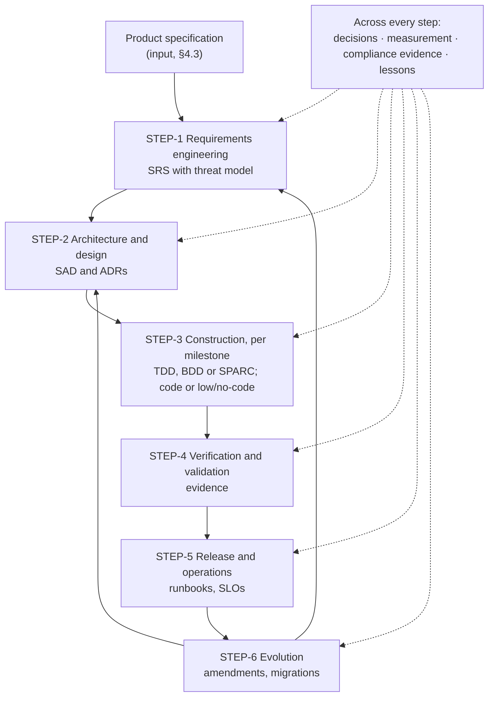

# Narthex: overview

A short reading of `SPEC.md` v0.3.0 for someone new to the project: what Narthex is, who it is for, how it
works, what exists today, and what is still open. Identifiers in `code` point to the spec. External sources are
in `REFERENCES.md`.

Narthex was called SDD Studio until 2026-10-17. Pablo dropped that name (ruling R1) and picked Narthex as the
codename. The final name is open (`OQ-1`).

## 1. What Narthex is

Narthex turns the AI agent a person already uses into a senior software architect. It does so with two things:

- **a knowledge base:** the method, templates, explanations, question sets and sector material the architect
  needs;
- **tools:** an MCP server the agent calls, a web GUI where people read and decide, and checks that run
  locally and in CI.

The architect guides people from a product specification to software in production. It covers requirements
engineering, architecture, construction, verification, release and evolution. It works for one agentic team or
several, and with code, low-code or no-code per component.

Narthex has no conversational agent of its own (R9). The user's agent talks to the user; Narthex gives it
structure, knowledge and checks.

The name comes from the myth. Prometheus carried fire to mankind in a narthex, the hollow stalk of the giant
fennel. Here the fire is the ability to build software at production scale. In a church, the narthex is also
the entrance hall for people who have turned toward the faith but not yet joined. Narthex's users are people
turned toward software engineering who have not yet graduated.

## 2. Who it is for

In this order (R12):

1. **Bloque's teams**, many of whose members are not software engineers;
2. **individual engineers of any discipline:** a civil engineer, a self-taught coder, a software engineer;
3. **software factories and consultants**, last. They can read the book Pablo plans on the whole system (R6).

At sign-up, Narthex places each person at one of three experience levels: newcomer, practitioner or
professional (§3.3). The level changes how much the architect explains and asks. It never loosens a check
(`INV-12`).

## 3. The chain

The input is a **product specification**: who the users are and what they need, goals and non-goals, the
product map, success measures, constraints and open questions (§4.3). Narthex defines this contract and checks
it. Producing the product specification is a separate product (R5, R14). For a newcomer, the user's agent asks
guided questions from the knowledge base to get there. An engineer gets a shorter questionnaire, a restated
prompt, or a standard form.

Each step ends at a gate made of deterministic checks, AI-assisted reviews, and a decision where a person must
judge (`REQ-CHN-3`). Two steps matter most to a non-engineer:

- **threat modelling** sits inside requirements engineering, so security is a requirement from the start
  (`REQ-CHN-7`);
- **validation** is separate from verification. It asks whether this is the right product, judged by the owner
  of the product specification, who can be a non-engineer (`REQ-CHN-13`).

The first question of every project is its sector (`REQ-ITK-9`). The sector picks a profile: a data file that
sets the sections, notation, trace rules, evidence and gates for that domain (§6.6). Candidates run from
`product` (SaaS and APIs) to `safety` (avionics, automotive, medical), with `oss-ledger` for Bloque's case.

## 4. The capabilities

| Capability | What it does | Spec |
|---|---|---|
| Knowledge base and sector profiles | Serves the method and sector material. Open standards' text may ship; otherwise checklists and guidance labelled supplementary; closed standards show "early preview" or "our standard way" (R4) | §7.1 |
| Decisions | Every question for a person is an item on a form, answered in the GUI and read back by the agent as data | §7.2 |
| Living documentation | Renders the repo's Markdown with an anchor per identifier, backlinks to decisions and checks, and editions from one commit | §7.3 |
| Workflow skills | One skill per step: intake, research, spec, design, decide, plan, dispatch, review, experiment, amend, propose upstream, release, report. Each carries the house rules into its briefs | §7.4 |
| Experiments | Bounded trials whose questions stay in their own log until an outcome is promoted | §7.5 |
| Verification and guardrails | Checks tagged with the identifiers they verify; alarms routed by who owns each identifier | §7.6 |
| Integrations and identity | An app on the user's own GitHub, GitLab or Codeberg repos; short-lived tokens per agent and task; commits that verify | §7.7 |
| Interfaces | An MCP server in five groups (knowledge, spec data, change, verify, decide) and a web GUI | §7.8 |
| Multiple teams | Identifier ownership per team, routing per role, conflict handling, one shared methodology store | §7.9 |

### How a decision travels

1. The agent files an item and gets a link from the MCP. The link is authenticated: reading uses a short-lived
   token; answering uses a long-lived token limited to one form and to submitting answers, so an answer that
   takes hours still lands (R20, `INV-17`).
2. The agent hands the link to the person. The person decides in the GUI, on a phone if needed, without long
   text in the chat (R3).
3. Forms are usually unattended for a while (R22). The agent doesn't poll. It opens a monitor where the harness
   has one, or asks the person to come back and acknowledge once they have answered. Meanwhile it carries on
   with its queue.
4. The answer comes back by the best path the harness offers: a plugin hook first, otherwise the link and a
   later read (R21). Each read returns only what changed since the last one (R8).
5. The agent archives the answer in the repo. A ruling reaches the spec only through an amendment that cites
   the item.

## 5. What exists today

- **The decision-form skill** (`skills/decision-form/`). A stock-Python builder turns `decisions/questions.json`
  into one self-contained page, published as a claude.ai artifact, and writes `decisions/LOG.md`. It supports
  sections in a decision's order, defaults, reserved items, supersession, follow-ups and relayed rulings. This
  repository's own form runs on it.
- **specsite v0.1** (`swimmingoncode/specsite`, MIT, in progress). A Starlight plugin that anchors each
  identifier and links every mention across documents, plus `specsite html` for single-file editions. Backlinks
  from decisions, the broken-reference check, tombstones and PDF are still to come (`REQ-DOC-13`).
- **The method in use on Bloque projects.** aledgent, Kippu and usage subscriptions ran it by hand between
  2026-09 and 2026-10 (private use-case reports). Their lessons are in the spec: stable identifiers, rulings as data,
  one worktree per agent, a review step, a token budget. `ADOPTING.md` says how a project takes it up today,
  and `case-studies/aledgent/index.html` tells the aledgent story with figures.

The MCP server, the web GUI, the sector profiles and the remaining skills do not exist yet.

## 6. Decided and open

**Decided** by Pablo's rulings R1 to R22 of 2026-10-17 (`notes/2026-10-17-rulings.md`) and earlier answers:

- the codename, the first customers, and the chain;
- the interface (MCP plus a web GUI, with links into the GUI), the MCP's five groups, incremental reads,
  authenticated links split by purpose, layered delivery of answers, and unattended forms;
- user-owned repositories through git-host apps; sign-up that profiles the user;
- multiple teams, low-code and no-code, the treatment of sector material, the minimum product-spec contract;
- no conversational agent of Narthex's own for now;
- the MIT licence; Markdown as the source of truth; shared tools as public repositories.

**Assumed** until Pablo confirms them: 56 recommended options folded into the spec, listed in SPEC §13 and
confirmed on five form items, `v3-asm-trust`, `v3-asm-method`, `v3-asm-form`, `v3-asm-docs` and `v3-asm-packaging`.

**Open**, each an item on the form (SPEC §11):

| Question | ID |
|---|---|
| The final name | `OQ-1` |
| Where newcomers' repositories live | `OQ-2` |
| Pricing and the business model | `OQ-3` |
| Which sector profiles ship first | `OQ-4` |
| Whether a profile may make an executable or formal spec normative | `OQ-5` |
| Whether an agent counts as an independent reviewer | `OQ-6` |
| Whether every amendment bumps the spec version | `OQ-7` |
| What an agent does on a spec gap | `OQ-8` |
| How tests are named | `OQ-9` |
| When a builder's change needs an engineer (the alarm tiers) | `OQ-10` |
| Which builder and product pilot Narthex at Bloque | `OQ-11` |
| Who checks the legal side of sector material, and when | `OQ-12` |

## 7. Where to read more

- `SPEC.md`: the normative specification, with the map from v0.2.0 in Appendix A.
- `REFERENCES.md`: the external sources, by topic.
- `notes/2026-10-17-product-definition-review.md`: the product definition and the full chain.
- `notes/2026-10-17-research-spec-formats.md`: how each industry writes specs.
- `history/amendments-v0/`: the amendments to SDD Studio's spec, now folded in.
