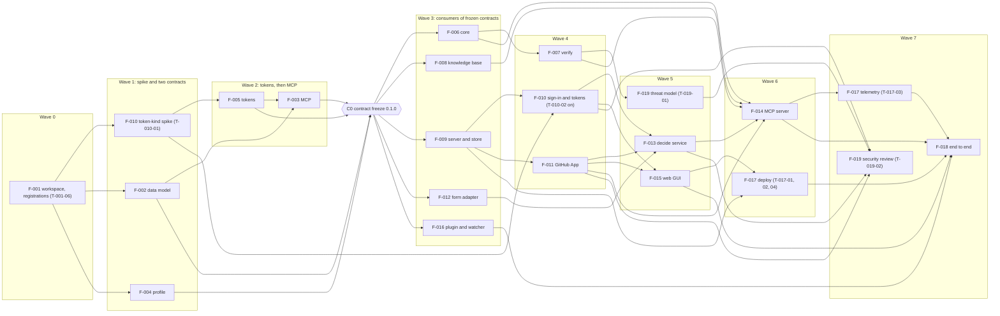

# Narthex: implementation plan

This is the plan of Narthex itself, written in `STEP-3` of its own chain (`REQ-SKL-6`). It turns the SAD
(`docs/architecture/SAD.md`) and its ADRs into milestones, features and tasks. It serves `SPEC.md` v0.3.6.
It does not change the spec or the SAD. Where it departs from the SAD, it says so in a plan decision.

---

## 1. How to read

Read §3 first for the big picture, then §4 for the first milestone in detail. §2 holds the rules the build
follows. §5 shows what runs in parallel. §6 lists risks and the questions for the lead. §7 shows that every
requirement has a home.

### Identifiers

| Prefix | Meaning | Example |
|---|---|---|
| `DEC-*` | A plan decision | `DEC-17` |
| `M-*` | A milestone. Written `M0`, `M1` in prose | `M-0` is M0 |
| `F-NNN` | A feature: one goal, one agent at a time, one worktree | `F-010` |
| `T-NNN-NN` | A task of feature `F-NNN`: exactly one pull request | `T-010-03` |

Identifiers are stable. A withdrawn one is never reused (`REQ-DAT-5`). New plan ids are reserved in
`.narthex/registry.json` before use (`REQ-DAT-8`, `T-001-05`).

### Task tables

Each task row names the files or packages it touches, the tests that prove it, and when it is done. Test names
are plain, as the house rules require (`REQ-SKL-30`, `OQ-9`). The identifiers in square brackets after a test
name go in a comment on that test, `// verifies: INV-17`, which the trace checks read. A test marked (L2) is an
invariant check (`DEC-16`); it is built in the task that builds the code it checks. "Done when" is always a
condition a script can decide (`REQ-SKL-14`).

### Status of plan decisions

`accepted` means an ADR or a ruling backs it. `proposed` means it is a plan-only choice that stands unless the
lead objects when reading this plan. `pending <item>` means a form item must be answered first. Until then the
stricter reading applies (`REQ-SKL-24`).

### Rulings applied in v0.2.0

The lead answered four plan items on 2026-10-17 (archived in `decisions/responses/2026-10-17T23-45.json`). The
other plan items keep their defaults.

| Item | Ruling | Applied in |
|---|---|---|
| `plan-merge-rule` | Yes, except sign-in, keys and contracts | `DEC-17`, `T-001-03` |
| `plan-test-budget` | Up to $3 a run, five runs each | `DEC-16`, `E5` of M1, `F-025` |
| `plan-watch-key` | Long-lived listening key, no content | `DEC-7`, `T-005-01`, `T-010-04`, `T-013-03`, `T-016-01`, risk 4 |
| `plan-web-address` | Subdomains of a domain we already hold | `DEC-4`, `T-017-04`; the domain itself waits on the `act` item `a-domain` |

---

## 2. Plan decisions

### 2.1 From the ADRs

| ID | Decision | Source | Status |
|---|---|---|---|
| `DEC-1` | TypeScript on the current Node.js LTS line (24 on 2026-10-17; check the schedule when M0 starts), pinned in `.nvmrc` and `engines`. The form builder stays stock Python and the server calls it as a subprocess | ADR-0001 | accepted by default |
| `DEC-2` | The official MCP TypeScript SDK, pinned. Streamable HTTP when hosted, stdio for local use. The contract lists 14 tools; M0 builds 10 of them and M1 the other 4 (`F-014`, `F-023`) | ADR-0002 | accepted by default |
| `DEC-3` | Astro for the GUI, server-rendered in middleware mode inside the server process. The decision form stays the builder's page | ADR-0003 | accepted by default |
| `DEC-4` | One rented server in the EU, as containers. Opening and paying for the account is an `act` item filed by `T-017-04`. The first hosted version uses subdomains of a domain Swimming on Code already holds; no domain is bought now (item `plan-web-address`). Which domain is the `act` item `a-domain` | ADR-0004; item `plan-web-address` | accepted (Pablo); the domain waits on `a-domain` |
| `DEC-5` | PostgreSQL only, plain SQL migrations with rollback scripts, the job queue on PostgreSQL. The typed query builder is Kysely | ADR-0005; Kysely is a plan choice | accepted by default |
| `DEC-6` | Sign-in and agent authorization with an embedded library, Better Auth first, after the spike `T-010-01`. If the spike fails, Keycloak. A security review gates the first outside user (`T-019-02`) | ADR-0006 | accepted (Pablo) |
| `DEC-7` | Opaque, purpose-bound tokens; answer links valid until revoked. The table is frozen as the token contract (`F-005`). One more purpose, `watch`, is ruled in addition to ADR-0007 (item `plan-watch-key`): a long-lived listening key that lasts until the form closes or the lead revokes it. It carries no content: the stream it opens sends only cursors and event kinds, never an answer, a question or a field. It is a keyed hash like every token, revocable, and valid on the event stream and nowhere else. The table in the token contract gains one row (`T-005-01`) | ADR-0007; item `plan-watch-key` | accepted (Pablo) |
| `DEC-8` | GitHub App first, behind one adapter interface. GitLab and Codeberg in M1 (`F-021`, `F-022`) | ADR-0008 | accepted by default |
| `DEC-9` | Form migration phases 1 and 2 in M0 (`F-012`, `F-013`); phases 3 and 4 in M1 (`F-024`) | ADR-0009 | accepted by default |
| `DEC-10` | Answer delivery layers 2 to 4 (watcher, short wait, acknowledge) in M0. The channel layer waits until channels leave preview | ADR-0010 | accepted by default |
| `DEC-11` | One monorepo with npm workspaces in the ADR-0011 layout. One change: the frozen contracts live in `contracts/` at the root, not in `packages/core/schemas/` (`DEC-14`) | ADR-0011 | accepted by default; the path change is proposed |
| `DEC-12` | One verify engine for the CLI, the MCP and CI. M0 uses the exit code only; posting results to the API (OIDC) comes with the alarms in M3 | ADR-0012 | accepted by default |
| `DEC-13` | The knowledge base as versioned files in `kb/`. Paid packs never enter the repo | ADR-0013 | accepted by default |

### 2.2 Plan-only decisions

| ID | Decision | Status |
|---|---|---|
| `DEC-14` | **Contracts.** Four contracts live in `contracts/`: `data-model/`, `mcp/`, `profile/` and `tokens/`. Each has a `version` field, fixtures and a conformance suite beside it. They are data, like `kb/`, so `packages/core` still depends on nothing of ours. They freeze at 0.1.0 when `F-002` to `F-005` merge (checkpoint C0). A change after C0 needs a version bump, a `contracts/CHANGELOG.md` entry and a new `DEC-*`; `T-001-05` enforces it. They are tagged 1.0.0 at M0's exit commit, as SAD §10.3 asks: the `version` fields move to 1.0.0 by a `contracts/CHANGELOG.md` entry that names this decision (`T-018-08`) | proposed |
| `DEC-15` | **Construction method per milestone** (`REQ-CHN-11`). M0: TDD, contract first (fixtures and conformance suites before any implementation). M1: TDD, plus BDD scenarios for the synthetic sessions. M2 onward: TDD | proposed |
| `DEC-16` | **Test layers** (from `notes/2026-10-17-testing-narthex.md`). L1 components: unit, contract and conformance tests on every PR, plus property tests for the data-model and token contracts. L2 invariants: checks tagged `INV-*`, on every PR that touches their packages and nightly. Each feature builds the L2 checks of its own invariants; `F-018` holds the runner, the nightly run and the checks that need the whole stack. L3 synthetic sessions: persona agents, before each release from M1. L4 real use: dogfooding from M0, the Bloque pilot. M0 has no persona agents; its end-to-end tests are scripted (`F-018`). **Budget** (item `plan-test-budget`): a synthetic run may cost up to $3, and each scenario runs five times per release, so three scenarios cost at most $45 a release. A run that reaches the ceiling stops and counts as a failure. The $3 is an estimate; `F-025` measures the real cost and the lead reviews the ceiling if it is off by half | proposed; budget accepted (Pablo) |
| `DEC-17` | **Branches and PRs.** One PR per task. Branch `f-NNN/t-NNN-NN-slug`. The PR title starts with the task id; the body lists the ids it serves and its tests. Plain `git commit` with the author's own signing; no identity or signing override (`INV-8`). DCO sign-off (`git commit -s`) is added only in repos that require it: Narthex does not, specsite does. Agents wait on CI with one blocking shell command, never by polling (`REQ-SKL-28`). Rebase on `main`, CI green, then squash merge, so GitHub signs the merge commit (`REQ-IDN-6`). **Who merges** (item `plan-merge-rule`): an agent merges its own PR when every check passes and a fresh reviewer agent, not the author, finds nothing. These always wait for the lead's click, after a separate security review: sign-in (`apps/server/src/auth/`), links and tokens, keys and secrets, and the four contracts in `contracts/` (including each version bump). The lead's click is on the PR, never on a default (`INV-4`) | accepted (Pablo) |
| `DEC-18` | **Dispatch.** One agent per feature at a time, in the feature's own git worktree and build directory (`REQ-SKL-7`, `REQ-SKL-29`). Each task goes to a fresh agent in that worktree; the feature's `features/F-NNN-slug/notes.md` carries state between tasks. Sonnet by default, including `F-010` after the spike. Opus only for open design and the independent review: the token-kind spike (`T-010-01`), the contracts (`F-002` to `F-005`), the threat model (`T-019-01`) and the security review (`T-019-02`). Haiku for checks, including the single CI wait. At most two helpers at once, plus one CI watcher (`NFR-10`, `NFR-11`). The orchestrator writes no code and reads reports, not diffs | proposed |
| `DEC-19` | **Task size** (ADOPTING.md §8). A task fits one helper with an exact brief: one PR; about 400 changed lines or fewer, fixtures excluded; it names the files to read (a contract and one SAD section, never the whole spec); its brief carries the house rules in full (`REQ-SKL-18`); its exit check is a script. A task that grows past this is split before it starts | proposed |
| `DEC-20` | **Releases.** One version for server, CLI and plugin (ADR-0011). Each milestone exit is a minor release: M0 is 0.2.0 (the plugin is 0.1.0 today), M1 is 0.3.0. Patches as needed. The hosted service deploys tagged releases only, after L1 and L2 are green and, from M1, the L3 pass rates hold. Each hosted release is a reserved `act` item (`INV-4`) | proposed |
| `DEC-21` | **Technical defaults.** Fastify for HTTP; `node --test` with Node's type stripping; `tsc --noEmit`; Ajv for JSON Schema; fast-check for property tests; Biome for lint and format; Playwright for page tests. Changing one needs a `DEC-*` | proposed |
| `DEC-22` | **First experience level.** M0's question set and persona serve the `maker` level, not `newcomer` as SAD §10 says, because amendment 0006 added `maker` after the SAD and the lead plays one. The other levels follow in M1 (`F-026`) | pending `plan-first-level` (default applies) |
| `DEC-23` | **Outward actions in the plan.** Registering the GitHub App, creating a test organisation, buying anything, opening the hosting account and each hosted release are `act` items filed by the task that needs them, at that time (`INV-4`, `REQ-SKL-20`). No task performs one on a default | accepted (`INV-4`) |

---

## 3. Milestones

### M0: contracts and walking skeleton

**Goal.** Freeze the four contracts. Then run the thinnest end-to-end slice (SAD §10): one person signs in
with GitHub, connects their agent, goes from intake to an approved SRS under the `product` profile on a form
hosted by Narthex, and the answer reaches the agent without polling.

**Method.** TDD, contract first (`DEC-15`). **Features.** `F-001` to `F-019`.

**Exit criteria.** All must hold at one tagged commit.

| # | Criterion | Ids |
|---|---|---|
| E1 | The four contracts exist under `contracts/`, frozen at 0.1.0 at C0 and tagged 1.0.0 at this commit (`DEC-14`). Every conformance suite passes for every implementation that consumes it: the Python builder, `packages/core`, the server and the stub | `REQ-CHN-12` |
| E2 | `walking skeleton completes on a self-hosted copy` passes on the compose stack (`T-018-02`), and `walking skeleton completes on the hosted instance` passes against the hosted instance, from the same image (`T-018-07`) | `REQ-ITK-1`, `REQ-ITK-2`, `REQ-ITK-9`, `REQ-IDN-1`, `REQ-IDN-3`, `REQ-CHN-5`, `REQ-DOC-16`, `REQ-IDN-8` |
| E3 | `unattended form resumes from one wake-up` passes: the answer lands after the read link expired; the agent is woken once; it makes no `form_read` call before the wake-up and at most one `form_wait`; its next read returns only the changes | `INV-17`, `REQ-DEC-39`, `REQ-DEC-42`, `REQ-DEC-24` |
| E4 | The L2 invariant suite is green for `INV-2`, `INV-3`, `INV-4`, `INV-9`, `INV-11`, `INV-12`, `INV-16`, `INV-17`. The approval is archived by a signed commit and acknowledged | `REQ-DEC-25`, `INV-2` |
| E5 | On the recorded skeleton session: every tool response is 16 KB or less, the median 2 KB or less, every tool description 60 words or less. A 200-item form loads in under 2 s on throttled 4G at 375 px. The builder still imports only the standard library | `NFR-8`, `NFR-6`, `NFR-2`, `NFR-4` |
| E6 | The threat-model amendment is ruled. The security review of `F-010`, `F-011` and `F-013` has no open high or critical finding. Every one of the 15 items of "M0 must-have" in `docs/architecture/auth-practices.md` has a passing test or a recorded drill, and `T-019-02` ticks each | `REQ-CHN-7` |
| E7 | Every id §7 places in M0 has at least one test whose comment names it; `check-test-tags` reports zero gaps for them | `REQ-VER-4` |
| E8 | One dogfood run with a real Claude Code session is recorded in `features/F-018-skeleton/dogfood.md` (L4) | `REQ-CHN-13` (as a rehearsal) |

### M1: every sign-in, every host, the whole form on Narthex

**Goal.** Email, Google and Outlook sign-in; GitLab and Codeberg; the four remaining MCP tools; the decision
form fully on Narthex's site (ADR-0009 phases 3 and 4); the L3 synthetic-session harness with its first three
scenarios; intake for all four levels.

**Method.** TDD, plus BDD scenarios for L3 (`DEC-15`). **Features.** `F-020` to `F-026`.

**Exit criteria.**

| # | Criterion | Ids |
|---|---|---|
| E1 | A person can sign in by GitHub, GitLab, Codeberg, Google, Outlook and an email link, and a newcomer without a git host is guided to a GitHub account | `REQ-ITK-2`, `REQ-ITK-3` |
| E2 | The walking skeleton passes on a GitLab project. On Codeberg it passes, or an amendment records why `REQ-IDN-4` cannot be met there yet (ADR-0008) | `REQ-IDN-1`, `REQ-IDN-4` |
| E3 | All 14 tools pass the MCP conformance suite over both transports | `REQ-IFC-1`, `REQ-DAT-12` |
| E4 | New projects publish to Narthex by default; the artifact target still works; read-back merges both stores by latest `at` | `REQ-IFC-8`, `INV-2` |
| E5 | Each of the three L3 scenarios passes in at least 4 of 5 runs, every run under the ceiling of $3 (item `plan-test-budget`) | `REQ-DEC-39`, `REQ-SKL-24`, `NFR-9` |
| E6 | The question sets cover all four levels, and the level changes no check result | `REQ-ITK-7`, `INV-12` |

### M2 onward

| Milestone | Goal | Main ids |
|---|---|---|
| M2: profiles and documents | The `oss-ledger`, `reg-fintech`, `protocol` and `safety` profiles (copyrighted material waits for the lawyer's check); every sector listed at intake; several profiles per project; rendered documents with anchors, backlinks and PDF on Narthex's host | `REQ-KNB-7`, `REQ-KNB-9`, `REQ-ITK-11` to `REQ-ITK-15`, `REQ-DAT-19`, `REQ-DOC-1` to `REQ-DOC-15`, `INV-6`, `INV-15` |
| M3: teams and guardrail alarms | Organisations with several teams, roles, an ownership file, routing; green, amber and red alarms from CI through the API | `REQ-TEM-1` to `REQ-TEM-7`, `REQ-VER-6` to `REQ-VER-9`, `REQ-VER-11` |
| M4: the whole chain and hosted launch | The remaining skills (`research`, `design`, `plan`, `dispatch`, `review`, `amend`, `release`, `report`, `experiment`, `propose-upstream`); gates for `STEP-2` to `STEP-6`; AI-assisted reviews; open sign-up on the hosted service with runbooks and SLOs; plans and prices once `OQ-3` is ruled | `REQ-CHN-1` to `REQ-CHN-18`, `REQ-SKL-2` to `REQ-SKL-13`, `REQ-EXP-1` to `REQ-EXP-7`, `REQ-VER-2`, `REQ-VER-5`, `REQ-VER-13` |
| M5: the Bloque pilot (L4) | Bloque uses Narthex on real work; the pilot measures of the testing note are reported; every incident becomes an L3 scenario. The start date waits on item `plan-pilot-start` (default: after M1, in parallel with M2 to M4) | `REQ-CHN-13`, `OQ-11` |

---

## 4. Features and tasks

### 4.1 M0 features

| Title | Feature | Model | Depends on | Contracts | Tasks |
|---|---|---|---|---|---|
| Workspace, CI and house rules | `F-001` | Sonnet | none | creates the guard for all four | 6 |
| Contract: data-model schemas | `F-002` | Opus | `F-001` | implements data-model | 4 |
| Contract: MCP tools and resources | `F-003` | Opus | `F-002`, `F-005` | implements mcp; consumes data-model, tokens | 4 |
| Contract: profile schema and `product` | `F-004` | Opus | `F-001` | implements profile | 3 |
| Contract: token model | `F-005` | Opus | `F-001`, `T-010-01` | implements tokens | 2 |
| Core model | `F-006` | Sonnet | C0 | consumes data-model, profile | 5 |
| Verify engine and CI action | `F-007` | Sonnet | `F-006` | consumes data-model, profile | 4 |
| Knowledge base, M0 content | `F-008` | Sonnet | C0 | consumes profile, mcp (kb pieces) | 3 |
| Server foundation and inbox store | `F-009` | Sonnet | C0 | consumes data-model | 4 |
| Sign-in and tokens (GitHub) | `F-010` | Sonnet (spike `T-010-01`: Opus) | `F-009`; the spike `T-010-01` needs only `T-001-01` and `T-001-06` | implements tokens; consumes mcp | 8 |
| GitHub App connector | `F-011` | Sonnet | `F-009`, `T-001-06` | consumes tokens | 4 |
| Form builder store adapter | `F-012` | Sonnet | C0 | consumes data-model, mcp (endpoints) | 4 |
| Decide service: publish, answers, events | `F-013` | Sonnet | `F-010`, `F-011`, `F-012` | consumes data-model, mcp, tokens | 4 |
| MCP server, 10 tools, both transports | `F-014` | Sonnet | `F-006`, `F-007`, `F-008`, `F-011`, `F-013` | implements mcp | 6 |
| Web GUI: sign-in, profile, projects | `F-015` | Sonnet | `F-010`, `F-011` | consumes tokens | 4 |
| Agent plugin: watcher and skills | `F-016` | Sonnet | C0 | consumes mcp, data-model | 7 |
| Deploy and operations | `F-017` | Sonnet | `F-009`, `F-015`; `T-017-03` also `F-014` | none | 4 |
| Walking skeleton end to end | `F-018` | Sonnet | `F-014`, `F-015`, `F-016`, `F-017` | consumes all four | 8 |
| Threat model and security review | `F-019` | Opus | `T-007-03` (`T-019-01`); `F-010`, `F-011`, `F-013` (`T-019-02`) | reviews tokens, mcp | 2 |

C0 is the contract freeze: `F-002` to `F-005` merged, which includes the sign-in spike `T-010-01` that `F-005` waits on. M0 has 86 tasks.

#### `F-001` Workspace, CI and house rules

- **Goal:** the empty monorepo of ADR-0011, CI for every layer, the house rules and the guards every later
  agent works under.
- **Serves:** `REQ-SKL-17`, `REQ-SKL-18`, `REQ-SKL-19`, `REQ-SKL-23`, `REQ-SKL-27`, `REQ-SKL-20`, `REQ-SKL-30`,
  `REQ-DAT-8`, `INV-8`, `INV-4`, `NFR-4`.
- **Depends on:** none. **Contracts:** creates the contract guard used by all four.

| Task | Work | Tests | Done when |
|---|---|---|---|
| `T-001-01` | Root `package.json` with workspaces `apps/*`, `packages/*`; `.nvmrc`; `tsconfig.base.json`; `biome.json`; empty `apps/server`, `apps/web`, `packages/core`, `packages/verify`, `packages/cli`, `packages/form-adapter`; `scripts/check-boundaries.mjs` | `workspace typechecks`; `core imports nothing of ours`; `nothing imports apps` [ADR-0011 boundaries] | `npm ci && npm run check` passes locally and in CI |
| `T-001-02` | `.github/workflows/ci.yml`: add a Node job (typecheck, lint, `node --test` per workspace) and a PostgreSQL service job; keep the `decision-form` job as it is | existing builder tests; `ci runs every workspace's tests` [`NFR-4`] | CI is green on the PR and the `decision-form` job is unchanged |
| `T-001-03` | `HOUSE-RULES.md` (identity and signing, worktrees, no `/tmp`, merge rule of `DEC-17` with the paths that wait for the lead, test naming, waiting on CI with one blocking command); `scripts/check-test-tags.mjs` reading `// verifies:` and `# verifies:` comments; `scripts/check-checklist.mjs <file>`, which fails while a `- [ ]` box is unticked | `test without a verifies comment is reported`; `verifies comment with an unknown id is reported`; `checklist with an unticked box fails` [`REQ-SKL-30`, `REQ-SKL-17`] | the checkers run in CI in report mode |
| `T-001-04` | `hooks/hooks.json` and `hooks/guard.py` (stock Python) for the plugin: refuse identity or signing overrides and durable writes under `/tmp` | `commit with an author override is refused`; `commit with no-gpg-sign is refused`; `plain commit is allowed`; `write under tmp is refused` [`INV-8`, `REQ-SKL-19`, `REQ-SKL-23`, `REQ-SKL-27`] | tests pass and the plugin manifest registers the hook |
| `T-001-05` | `.narthex/registry.json` (plan ids, amendment and migration numbers); `scripts/check-registry.mjs`; `scripts/check-contracts.mjs`: a change under `contracts/` needs a version bump and a `contracts/CHANGELOG.md` entry naming a `DEC-*` | `duplicate task id is an error`; `migration number reserved twice is an error`; `contract change without a version bump fails` [`REQ-DAT-8`, `REQ-VER-1`, `DEC-14`] | both scripts run in CI and fail on their fixtures |
| `T-001-06` | Files the `act` items for the registrations that later tasks need before any hosted instance: a test GitHub App, a GitHub OAuth app for sign-in with a localhost callback, and a test organisation. Ids go in `features/F-001-workspace/notes.md`, secrets go in the secret store, never in the repo. `scripts/check-act-items.mjs` lists `act` items that are still unanswered | `unanswered act item is reported`; `answered act item passes` [`INV-4`, `REQ-SKL-20`] | the three `act` items are answered and `check-act-items` exits 0 for them |

#### `F-002` Contract: data-model schemas

- **Goal:** the six JSON Schemas of SAD §11.1 at 0.1.0, with fixtures both the Python builder and TypeScript
  agree on.
- **Serves:** `REQ-DEC-1`, `REQ-DEC-43`, `REQ-DAT-2`, `REQ-DAT-6`, `REQ-DAT-14`, `REQ-DAT-15`, `REQ-DAT-20`,
  `REQ-TEM-2`, `REQ-CHN-12`.
- **Depends on:** `F-001`. **Contracts:** implements data-model.

| Task | Work | Tests | Done when |
|---|---|---|---|
| `T-002-01` | `contracts/data-model/questions.schema.json` and `response.schema.json`, from `skills/decision-form/references/item-format.md`; valid and invalid fixtures, with this repo's `decisions/questions.json` as one valid fixture; `skills/decision-form/tests/test_contract_fixtures.py` | `valid questions fixtures pass the schema`; `invalid questions fixtures fail with the expected error`; `builder accepts every valid questions fixture`; `builder rejects every invalid questions fixture`; `generated valid items pass the schema and survive a round trip` (property test) [`REQ-DEC-1`, `REQ-DEC-43`, `REQ-DAT-6`] | Ajv and the builder agree on every fixture |
| `T-002-02` | `event.schema.json`: answer, edit, link request, publish, ack; cursors increase strictly per form | `event fixtures pass`; `event without a cursor fails`; `any generated event sequence has strictly increasing cursors` (property test) [`REQ-DEC-24`, `INV-3`] | fixtures pass in CI |
| `T-002-03` | `project.schema.json` and `ownership.schema.json`; `.narthex/project.json` for this repo (it names `docs/architecture/SAD.md` and `docs/architecture/adr/`) as a valid fixture | `this repo's project file passes`; `ownership pattern without a team fails` [`REQ-DAT-1`, `REQ-TEM-2`] | fixtures pass in CI |
| `T-002-04` | `trace.schema.json`, `needs.json` compatible (id, type, title, status, links, source); `contracts/data-model/README.md`; the 0.1.0 entry in `contracts/CHANGELOG.md` | `trace fixtures pass`; `link of an unknown type fails` [`REQ-DAT-20`] | fixtures pass and the contract guard accepts the version |

#### `F-003` Contract: MCP tools and resources

- **Goal:** the tool, resource and endpoint listing of SAD §11.2 at 0.1.0, a conformance runner for any server,
  and a stub that lets consumers build before the server exists.
- **Serves:** `REQ-IFC-1`, `REQ-IFC-2`, `REQ-IFC-4`, `REQ-IFC-6`, `REQ-IFC-7`, `REQ-IFC-9`, `REQ-KNB-2`,
  `REQ-DEC-24`, `NFR-8`.
- **Depends on:** `F-002`, `F-005` (which waits on the spike `T-010-01`). **Contracts:** implements mcp; consumes data-model and tokens.

| Task | Work | Tests | Done when |
|---|---|---|---|
| `T-003-01` | `contracts/mcp/tools.json`: the 14 tools with group, scope, phase (M0 or M1), description, input and output schemas, byte budgets (2 KB typical, 16 KB at most). Repository text in outputs sits in fields marked untrusted (SAD §6.6) | `contract lists exactly fourteen tools`; `ten tools are in phase M0 and four in phase M1`; `every description is sixty words or less`; `every scope exists in the token contract`; `no tool writes an answer` [`REQ-IFC-1`, `NFR-8`, `INV-4`] | tests pass |
| `T-003-02` | `resources.json` (`narthex://kb/{id}@{version}`, `narthex://profile/{name}@{version}`), `prompts.json` (`intake`, `spec`), `kb-piece.schema.json` (id, version, class, label, step, level, body) | `kb piece without a class fails`; `supplementary piece labelled normative fails` [`REQ-KNB-2`, `REQ-KNB-3`, `INV-14`] | tests pass |
| `T-003-03` | `endpoints.json`: the HTTP calls of the form page and the watcher (link exchange, answer submit, event stream, link request), each with its token purpose | `every endpoint names its token purpose`; `no endpoint takes a token in the query string` [`REQ-IFC-9`, `REQ-IFC-10`] | tests pass |
| `T-003-04` | `contracts/mcp/conformance/` (node:test; target from `NARTHEX_TARGET`, a URL or a stdio command); `contracts/mcp/stub/` that answers from fixtures | `the stub passes conformance over stdio`; `the stub passes conformance over streamable http` [`REQ-IFC-1`, ADR-0002] | both runs pass in CI |

#### `F-004` Contract: profile schema and `product`

- **Goal:** the profile schema of SAD §11.3 at 0.1.0, proven against the `product` instance and drafts of the
  other four.
- **Serves:** `REQ-DAT-9`, `REQ-DAT-10`, `REQ-DAT-17`, `REQ-DAT-18`, `REQ-KNB-3`, `REQ-KNB-6`, `REQ-KNB-11`,
  `INV-14`.
- **Depends on:** `F-001`. **Contracts:** implements profile.

| Task | Work | Tests | Done when |
|---|---|---|---|
| `T-004-01` | `contracts/profile/profile.schema.json`; invalid fixtures | `profile without gates fails`; `standard without a pinned edition fails`; `supplementary standard marked normative fails` [`REQ-DAT-18`, `REQ-KNB-6`, `INV-14`] | tests pass |
| `T-004-02` | Draft `oss-ledger`, `reg-fintech`, `protocol` and `safety` profiles as valid fixtures only (not shipped in `kb/`) | `each draft profile passes`; `safety draft needs a level parameter`; `profile that drops a universal part fails` [`REQ-DAT-9`, `REQ-DAT-10`] | tests pass |
| `T-004-03` | `kb/profiles/product.json` at 0.1.0: sections, families, RFC 2119 notation, trace rules, the `STEP-1` gate (input contract, trace to source, threats handled, lead's acceptance), the disclaimer | `product profile passes the schema`; `product step one gate lists the four checks` [`REQ-DAT-17`, `REQ-KNB-11`, `REQ-CHN-3`] | tests pass |

#### `F-005` Contract: token model

- **Goal:** ADR-0007's table as data at 0.1.0, and a conformance suite any token service must pass.
- **Serves:** `REQ-IFC-9`, `REQ-IFC-10`, `REQ-IFC-11`, `REQ-IDN-3`, `REQ-IDN-4`, `REQ-IDN-7`, `INV-17`, `NFR-3`.
- **Depends on:** `F-001` and the token-kind finding of `T-010-01`, so the contract is frozen after the spike. **Contracts:** implements tokens.

| Task | Work | Tests | Done when |
|---|---|---|---|
| `T-005-01` | `contracts/tokens/tokens.json`, `tokens.schema.json`, `tokens.md`: purposes, scopes, lifetimes, audience, transport (fragment, header, cookie), keyed-hash storage, written to match the token kind the spike `T-010-01` found. The `watch` purpose is included as `DEC-7` rules: it lasts until the form closes or the lead revokes it, and it carries no content | `every purpose has a lifetime and a transport`; `watch key ends when the form closes`; `watch key is valid on the event stream only`; `answer link has no expiry and is revocable`; `no purpose travels in a query string` [`INV-17`, `REQ-IFC-10`] | tests pass |
| `T-005-02` | `contracts/tokens/conformance/` with an in-memory reference service and an injected clock | `read link expires after its lifetime`; `answer submits after the read link expired`; `revoked answer link is refused`; `answer link cannot read later state`; `an unrevoked answer link submits at any generated clock offset` (property test) [`INV-17`, `REQ-IFC-9`, `REQ-IFC-11`] | the reference service passes; C0 can be declared |

#### `F-006` Core model

- **Goal:** `packages/core`: load contracts and `kb/`, parse a repo's documents, find identifiers and
  references, build the trace graph and its three queries, export `needs.json`.
- **Serves:** `REQ-DAT-1`, `REQ-DAT-3`, `REQ-DAT-4`, `REQ-DAT-5`, `REQ-DAT-7`, `REQ-DAT-11`, `REQ-DAT-12`,
  `REQ-DAT-20`, `REQ-CHN-6`.
- **Depends on:** C0. **Contracts:** consumes data-model and profile.

| Task | Work | Tests | Done when |
|---|---|---|---|
| `T-006-01` | `packages/core/src/contracts.ts`: load and validate against `contracts/` | `loader validates a project file`; `unknown contract version is refused` [`REQ-DAT-1`] | tests pass |
| `T-006-02` | `src/ids.ts`: definitions in headings, table rows and list items per the profile's families; references; fixture repos in `test/fixtures/` | `identifier defined in a table row is found`; `identifier defined twice is reported`; `reference to an unknown id is reported` [`REQ-DAT-5`, `REQ-DAT-7`] | tests pass |
| `T-006-03` | `src/trace.ts`: graph from documents, `verifies` comments and commit references; depends on, depended on by, impact | `impact lists every identifier a change touches`; `test tags become verified-by links` [`REQ-DAT-11`, `REQ-DAT-12`, `REQ-VER-4`] | tests pass |
| `T-006-04` | `src/export.ts`: `needs.json` export | `export of the fixture repo passes the trace schema` [`REQ-DAT-20`] | tests pass |
| `T-006-05` | `src/kb.ts`: `kb/` loader by `id@version`, with class and label | `piece is served by id and version`; `unchanged piece has the same version` [`REQ-KNB-2`, ADR-0013] | tests pass |

#### `F-007` Verify engine and CI action

- **Goal:** the M0 checks in `packages/verify`, run the same way by the CLI, the MCP and CI.
- **Serves:** `REQ-VER-1`, `REQ-VER-3`, `REQ-VER-4`, `REQ-VER-12`, `REQ-CHN-3`, `REQ-CHN-5`, `REQ-CHN-6`,
  `REQ-CHN-7`, `REQ-ITK-8`, `REQ-KNB-4`, `INV-12`, `INV-14`, `NFR-1`.
- **Depends on:** `F-006`. **Contracts:** consumes data-model and profile.

| Task | Work | Tests | Done when |
|---|---|---|---|
| `T-007-01` | Check runner and findings format; dangling references, duplicate ids (including tasks and migrations from the registry), trace gaps | `dangling reference is a finding`; `duplicate migration number is a finding` [`REQ-VER-1`] | tests pass |
| `T-007-02` | Input-contract check of `PRODUCT.md` against §4.3; each gap yields a draft item valid under `questions.schema.json` | `missing success measures yields one gap item`; `element answered unknown passes as an assumption` [`REQ-CHN-5`, `REQ-ITK-8`] | tests pass |
| `T-007-03` | The `product` profile's `STEP-1` gate: trace to source, threats mitigated or accepted, profile violations, the acceptance item answered; label check of kb pieces; the builder in `--check` mode | `requirement without a source fails the gate`; `threat without mitigation or acceptance fails the gate`; `the level does not change any finding` (L2); `supplementary piece shown as normative is a finding` [`REQ-CHN-3`, `REQ-CHN-6`, `REQ-CHN-7`, `INV-12`, `INV-14`, `NFR-1`] | tests pass |
| `T-007-04` | `narthex verify` in `packages/cli`; `action.yml` (composite action) running it; Narthex runs it on its own repo in CI | `cli and library report the same findings`; `verify runs with no service` [`REQ-VER-3`, `REQ-VER-12`] | CI runs it on this repo |

#### `F-008` Knowledge base, M0 content

- **Goal:** the pieces the skeleton needs: the intake question set for the first level, templates for
  `PRODUCT.md` and `SPEC.md`, the `STEP-1` explanation, labels and disclaimers.
- **Serves:** `REQ-KNB-1`, `REQ-KNB-5`, `REQ-KNB-8`, `REQ-KNB-10`, `REQ-KNB-11`, `REQ-KNB-12`, `REQ-ITK-7`,
  `NFR-7`.
- **Depends on:** C0. **Contracts:** consumes profile and the kb-piece schema.

| Task | Work | Tests | Done when |
|---|---|---|---|
| `T-008-01` | `kb/index.json`; `kb/intake/<level>/` question sets, one per §4.3 element, each with why it matters and a reading chain. The level is `maker` unless item `plan-first-level` says otherwise (`DEC-22`) | `every contract element has questions for the level`; `every piece passes the kb piece schema`; `every guidance piece gives a reading chain` [`REQ-ITK-7`, `REQ-KNB-10`] | tests pass |
| `T-008-02` | `kb/templates/PRODUCT.md`, `kb/templates/SPEC.md` (with threat model and assumptions sections); `kb/steps/step-1/<level>.md` | `spec template has every section the product profile requires`; `product template has every contract element` [`REQ-KNB-1`, `REQ-CHN-7`] | tests pass |
| `T-008-03` | Labels for "our standard way" and the no-sector disclaimer; `scripts/check-kb-sources.mjs` against `REFERENCES.md`; MIT notice in `kb/` | `piece citing a source missing from references is reported`; `standard flow piece shows the disclaimer` [`REQ-KNB-5`, `REQ-KNB-8`, `REQ-KNB-11`, `REQ-KNB-12`] | tests pass |

#### `F-009` Server foundation and inbox store

- **Goal:** `apps/server` as one Node process with config, logs, the PostgreSQL schema of SAD §5.2, the
  append-only event feed and the job queue.
- **Serves:** `REQ-DAT-15`, `REQ-DEC-24`, `INV-2`, `INV-3`, `NFR-5`, `REQ-IDN-8`.
- **Depends on:** C0. **Contracts:** consumes data-model.

| Task | Work | Tests | Done when |
|---|---|---|---|
| `T-009-01` | Fastify app; config from the environment (SAD §6.4); JSON logs with request ids that never carry tokens or answer text; `/health` | `logs never contain a token value`; `health returns the version` [SAD §8] | tests pass |
| `T-009-02` | `apps/server/migrations/NNNN-*.sql` with rollback scripts for the tables of SAD §5.2; Kysely types; numbers from the registry | `every migration applies and rolls back on an empty database` [ADR-0005] | tests pass on the CI PostgreSQL |
| `T-009-03` | Store layer for `event`, `answer`, `cursor`; no update or delete on events or answers except `archived_at` | `a changed answer adds a row and keeps the old one` (L2); `events after a cursor come in order` (L2) [`INV-3`, `REQ-DEC-24`, `INV-2`] | tests pass |
| `T-009-04` | In-process job queue on PostgreSQL; audit log writer | `a job runs once under two workers`; `audit entries are append only` [ADR-0005, SAD §8] | tests pass |

#### `F-010` Sign-in and tokens (GitHub)

- **Goal:** people sign in with GitHub; agents connect with OAuth 2.1; the token service passes the token
  contract. Every task checks its part of "M0 must-have" in `docs/architecture/auth-practices.md`. The spike
  `T-010-01` runs in wave 1, before `F-005`. The other tasks run after `F-009` in the order 02, 03, 06, 07, 04, 08,
  05.
- **Serves:** `REQ-ITK-2`, `REQ-IDN-3`, `REQ-IFC-9`, `REQ-IFC-10`, `REQ-IFC-11`, `REQ-TEM-4`, `INV-4`, `INV-17`,
  `NFR-3`.
- **Depends on:** `F-009`; `T-010-01` needs only `T-001-01` and `T-001-06`. **Contracts:** implements tokens;
  consumes mcp (scopes).

| Task | Work | Tests | Done when |
|---|---|---|---|
| `T-010-01` | Spike (ADR-0006), run by Opus in wave 1, report in `features/F-010-signin/spike.md`: Better Auth pinned, its MCP plugin against a real Claude Code client, GitHub sign-in (with the OAuth app of `T-001-06`), an email link, GitLab and Codeberg through generic OAuth, its advisory history; plus "Gaps to close in the spike" of `auth-practices.md` | spike scripts only, not merged as product code | the report states **whether the MCP plugin issues opaque or signed access tokens** and how that meets ADR-0007's opaque rule (or names the change needed); it answers each spike gap; the orchestrator records Better Auth or Keycloak as a new `DEC-*`; only then does `T-005-01` start |
| `T-010-02` | `apps/server/src/auth/`: GitHub sign-in, sessions, identity keyed on provider and subject, idle and absolute timeouts, logout everywhere, the device list. Must-have items 7, 9 and 10 | `session cookie uses the host prefix and is http only and secure`; `session ends after thirty idle days`; `session ends at its absolute limit`; `session id changes on privilege change`; `same email from another provider is not linked`; `implicit account linking is off`; `logout everywhere ends every session`; `device list shows each session and revokes one` [`REQ-ITK-2`] | tests pass and items 7, 9, 10 are checked |
| `T-010-03` | OAuth 2.1 endpoints for the MCP: code flow with PKCE S256, exact redirect match, RFC 9728 metadata, audience checks, scope challenges, no token passthrough. Must-have items 1 and 2 | `authorization without pkce is refused`; `redirect that is not an exact match is refused`; `token for another audience is refused`; `metadata names the resource and its scopes`; `call without enough scope gets a scope challenge` [`REQ-IDN-3`, `REQ-IFC-9`] | tests pass and items 1, 2 are checked |
| `T-010-04` | Link tokens: read link, answer link, refresh request, and the watch key; fragment-to-session exchange over POST; revoke and reissue; keyed hashes with versioned secrets and the pepper in the secret store. Must-have items 3 and 12 | `the server passes the token conformance suite`; `token is stored as a keyed hash`; `token carries its purpose prefix`; `token in a query string is refused`; `key rotation keeps links issued under the old key valid until they expire`; `pepper is read from the secret store`; `answer submits after the read link expired` (L2); `revoking the watch key ends its stream`; `watch key is refused on every route but the event stream` [`INV-17`, `REQ-IFC-10`] | tests pass and items 3, 12 are checked |
| `T-010-05` | Throttling per token and per project with a shared store and a trusted IP header; uniform errors; security headers; audit of sign-ins, issues and revokes; pinned versions, an advisory watch and the auth regression suite in CI. Must-have items 8, 13, 14, 15 (the incident drill of item 15 is `T-017-02`) | `too many answers from one token are refused`; `known and unknown accounts get the same error`; `forwarded ip is trusted only from the proxy`; `every token issue is audited`; `responses carry the security headers`; `lockfile pins the auth library`; `auth regression suite runs in ci` [SAD §6.5] | tests pass and items 8, 13, 14, 15 are checked, item 15 apart from the drill |
| `T-010-06` | Clients and consent: pre-registered clients and Client ID Metadata Documents, dynamic registration off, an SSRF-safe metadata fetcher; the consent page per person and per client; the connected-agents list with revoke. Must-have items 5 and 6 | `registration endpoint is absent`; `client metadata at a private address is refused`; `consent is asked per person and per client`; `revoking a connected agent ends its tokens` [`REQ-IDN-3`] | tests pass and items 5, 6 are checked |
| `T-010-07` | Refresh tokens: rotation, family revocation on reuse, absolute expiry, a grace of 10 seconds or less; the `mcp` purpose runs the token conformance suite. Must-have item 4 | `refresh token reuse revokes the family`; `refresh token stops at its absolute expiry`; `reuse inside the grace window is allowed once`; `the mcp purpose passes the token conformance suite` [`REQ-IDN-3`, `INV-17`] | tests pass and item 4 is checked |
| `T-010-08` | Answer checks on the answer endpoint: form and project routing, reserved items by the lead only, a fresh session for reserved answers and for link reissue. Must-have item 11 | `reserved item answered by a non-lead is refused` (L2); `reserved item is never answered by its default` (L2); `reserved answer needs a fresh session`; `link reissue needs a fresh session`; `answer for another form is refused` [`INV-4`, `REQ-TEM-4`] | tests pass and item 11 is checked |

#### `F-011` GitHub App connector

- **Goal:** the adapter interface of ADR-0008 with GitHub as its one implementation.
- **Serves:** `REQ-IDN-1`, `REQ-IDN-2`, `REQ-IDN-4`, `REQ-IDN-5`, `REQ-IDN-6`, `INV-16`.
- **Depends on:** `F-009` and `T-001-06` (the test GitHub App). **Contracts:** consumes tokens (git task purpose).

| Task | Work | Tests | Done when |
|---|---|---|---|
| `T-011-01` | `apps/server/src/githost/adapter.ts`; GitHub task-token minting scoped to repositories and permissions; recorded API fixtures | `task token is scoped to one repository`; `permission beyond the app's is refused` [`REQ-IDN-4`] | tests pass |
| `T-011-02` | Webhook receiver with signature check; an installation event registers a project | `webhook with a bad signature is refused`; `installation event creates one project` [`REQ-IDN-1`] | tests pass |
| `T-011-03` | Read files at a commit into a job working copy that is removed after the job; commits and PRs through the API as the app identity | `working copy is removed when the job ends`; `app commits go through the api so github signs them` (L2) [`REQ-IDN-2`, `REQ-IDN-5`, `REQ-IDN-6`, `INV-16`] | tests pass |
| `T-011-04` | `deploy/github-app.md` and `deploy/github-app-manifest.json` for self-hosters (manifest flow) | `manifest permissions match the adr list` [ADR-0008] | test passes |

#### `F-012` Form builder store adapter

- **Goal:** ADR-0009 phases 1 and 2 on the builder side: one adapter seam in the page, a Narthex adapter, a
  `--target narthex` build, and the phone and size checks.
- **Serves:** `REQ-DEC-17`, `REQ-DEC-18`, `REQ-DEC-19`, `REQ-DAT-3`, `REQ-DOC-16`, `INV-5`, `INV-13`, `INV-18`,
  `NFR-2`, `NFR-4`, `NFR-6`.
- **Depends on:** C0. **Contracts:** consumes data-model and `contracts/mcp/endpoints.json`.

| Task | Work | Tests | Done when |
|---|---|---|---|
| `T-012-01` | `skills/decision-form/assets/template.html`: move the storage calls behind one adapter interface (artifact and local adapters); no change in behaviour | existing builder tests; `page saves through the artifact adapter as before` [`REQ-DEC-17`] | all builder tests and the new page test pass |
| `T-012-02` | `packages/form-adapter`: the Narthex adapter (fragment exchange, answer POST, where it was saved, browser fallback with export and import), built to one inline script | `answer posts to the endpoint the contract names`; `store down keeps the answer in the browser` [`REQ-DEC-17`, `REQ-DEC-19`, `NFR-5`] | tests pass |
| `T-012-03` | `build.py --target narthex` inlines the adapter; the page states its commit and build time | `narthex target embeds the commit`; `builder imports only the standard library` [`REQ-DAT-3`, `INV-5`, `INV-13`, `NFR-4`] | tests pass |
| `T-012-04` | Playwright checks of the built page: 375 px, no horizontal scroll, 40 px targets, keyboard only, both themes; a 200-item form under 2 s with 4G throttling | `form fits a phone screen`; `form works with the keyboard only`; `two hundred item form loads in two seconds on 4g` [`NFR-2`, `REQ-DEC-18`, `NFR-6`] | tests pass in CI |

#### `F-013` Decide service: publish, answers, events

- **Goal:** the server side of ADR-0009 phase 2: publish at a commit with a lock, serve the page, take answers,
  feed events, read, wait and acknowledge.
- **Serves:** `REQ-DEC-22`, `REQ-DEC-23`, `REQ-DEC-24`, `REQ-DEC-42`, `REQ-IDN-7`, `REQ-IFC-6`, `INV-2`, `INV-9`,
  `INV-11`, `INV-18`.
- **Depends on:** `F-010`, `F-011`, `F-012` (and `F-009`). **Contracts:** consumes data-model, mcp (endpoints) and
  tokens.

| Task | Work | Tests | Done when |
|---|---|---|---|
| `T-013-01` | Publish job: run the builder with `--target narthex` at a commit, store the snapshot and page (disk or S3-compatible), database publish lock, one form per project | `publish with a stale base is refused`; `item from another project is refused` (L2); `unapproved item is not published` (L2); `publish records who approved it` [`REQ-DEC-22`, `INV-11`, `INV-9`] | tests pass |
| `T-013-02` | Serve the page on the user-content domain; the answer endpoint appends an answer event | `answer is stored as an event first`; `rebuilding a form keeps every answer` (L2) [`INV-2`, `INV-18`] | tests pass |
| `T-013-03` | Event stream (server-sent events) after a cursor, resuming from the last event id, with keepalives. It accepts the watch key and sends only the cursor and the kind of each event, never its content | `stream resumes after the last cursor`; `idle stream sends only keepalives`; `stream for a watch key carries no answer text` [`REQ-DEC-42`, ADR-0010] | tests pass |
| `T-013-04` | Read since a cursor; short wait then "pending"; acknowledge with the archive commit; link-request events; acknowledged answers age out after 30 days | `read returns only changes after the cursor`; `wait returns pending after its limit`; `only acknowledged answers age out` [`REQ-DEC-24`, `REQ-IFC-6`, `INV-2`] | tests pass |

#### `F-014` MCP server, 10 tools, both transports

- **Goal:** `apps/server/src/mcp` and `narthex mcp --stdio`, passing the MCP conformance suite for the 10 M0
  tools (the other 4 of the contract's 14 are `F-023` in M1): `knowledge_search`, `knowledge_get`, `spec_get`, `verify_run`, `items_file`, `form_publish`,
  `form_read`, `form_wait`, `form_ack`, `link_get`.
- **Serves:** `REQ-IFC-1`, `REQ-IFC-2`, `REQ-IFC-4`, `REQ-IFC-7`, `REQ-IFC-12`, `REQ-KNB-2`, `REQ-DEC-20`,
  `REQ-DEC-24`, `REQ-DEC-38`, `REQ-IDN-5`, `REQ-VER-3`, `NFR-8`.
- **Depends on:** `F-006`, `F-007`, `F-008`, `F-011`, `F-013`. **Contracts:** implements mcp.

| Task | Work | Tests | Done when |
|---|---|---|---|
| `T-014-01` | MCP module on the pinned SDK; Streamable HTTP endpoint; Origin check; access tokens from `F-010`; scope checks; tool registry generated from `contracts/mcp/tools.json` | `tool list equals the m0 tools of the contract`; `call without the tool's scope is refused` [`REQ-IFC-1`, ADR-0002] | tests pass |
| `T-014-02` | `knowledge_search`, `knowledge_get`, the kb and profile resources, `spec_get` | conformance for these tools; `search returns ids and titles only` [`REQ-IFC-2`, `REQ-KNB-2`] | conformance passes for these tools |
| `T-014-03` | `verify_run` on a job working copy; `items_file` ending as a commit or PR through the connector | `items file ends as a pull request`; `verify run returns the same findings as the cli` [`REQ-IDN-5`, `REQ-VER-3`] | tests pass |
| `T-014-04` | `form_publish` and `link_get` (suggesting the harness's own browser) | conformance for these tools; `links say to open in the harness browser` [`REQ-IFC-4`, `REQ-IFC-12`, `REQ-DEC-20`] | conformance passes for these tools |
| `T-014-05` | `narthex mcp --stdio` in `packages/cli`: knowledge, spec data and verify from the repo and the bundled kb, no account | `local mode passes conformance over stdio`; `local mode needs no account` [`REQ-DEC-38`, `REQ-IDN-8`] | the full suite passes over both transports in CI |
| `T-014-06` | `form_read` (ending with the reminder to update the form), `form_wait` and `form_ack` | conformance for these tools; `form read ends with the reminder to update the form`; `form wait returns pending and not an error` [`REQ-DEC-24`, `REQ-IFC-6`] | conformance passes for these tools |

#### `F-015` Web GUI: sign-in, profile, projects

- **Goal:** the M0 pages of `apps/web`: sign in, profile, install the app, list projects with their forms.
- **Serves:** `REQ-IFC-3`, `REQ-ITK-1`, `REQ-ITK-4`, `REQ-ITK-5`, `REQ-ITK-6`, `REQ-ITK-9`, `REQ-ITK-10`, `NFR-2`.
- **Depends on:** `F-010`, `F-011`. **Contracts:** consumes tokens (sessions).

| Task | Work | Tests | Done when |
|---|---|---|---|
| `T-015-01` | Astro in middleware mode mounted in the server; layout; light and dark; phone first | `pages fit a phone screen` [`NFR-2`] | tests pass |
| `T-015-02` | Sign-in page (GitHub); profile: sector first, then level, role and git host; see and change the level; a default sector per user | `sector is asked before any other project question`; `person can change their level`; `level changes guidance only` [`REQ-ITK-1`, `REQ-ITK-4`, `REQ-ITK-5`, `REQ-ITK-6`, `REQ-ITK-9`, `REQ-ITK-10`] | tests pass |
| `T-015-03` | Install the GitHub App on one repo; projects list with each project's step and its form link | `installed repo appears as a project` [`REQ-IFC-3`, `REQ-IDN-1`] | tests pass |
| `T-015-04` | Accessibility checks of the GUI pages in CI (keyboard only, contrast) | `gui pages work with the keyboard only` [`REQ-DEC-18`, `NFR-2`] | tests pass in CI |

#### `F-016` Agent plugin: watcher and skills

- **Goal:** the agent side of the skeleton, built against the MCP stub of `T-003-04`: the watcher, and the
  `intake`, `spec` and `decide` paths over the MCP.
- **Serves:** `REQ-DEC-21`, `REQ-DEC-25`, `REQ-DEC-30`, `REQ-DEC-31`, `REQ-DEC-33`, `REQ-DEC-39`, `REQ-DEC-40`, `REQ-DEC-41`, `REQ-DEC-42`, `REQ-IFC-6`,
  `REQ-SKL-1`, `REQ-SKL-3`, `REQ-SKL-5`, `REQ-SKL-14`, `REQ-SKL-20`, `REQ-SKL-21`, `REQ-SKL-22`, `REQ-SKL-32`,
  `REQ-SKL-33`, `REQ-SKL-34`, `NFR-9`.
- **Depends on:** C0. **Contracts:** consumes mcp and data-model.

| Task | Work | Tests | Done when |
|---|---|---|---|
| `T-016-01` | `narthex watch` in `packages/cli`: wait on the event stream after a cursor, exit with one line on the first event, reconnect with the last cursor, listen with the watch key until the form closes or the key is revoked, then say so; give up after a long limit with a message | `watcher exits on the first event after its cursor`; `watcher resumes after a dropped stream without repeating events`; `watcher outlives the read link` [`REQ-DEC-40`, `REQ-IFC-6`, `NFR-9`] | tests pass against the stub |
| `T-016-02` | `skills/decision-form/` gains the Narthex path, part one: publish through the MCP in batched passes, start the watcher in the background or tell the person to come back with the link, carry on without polling | `exit check fails when a published form has neither a watcher nor a come-back message`; `exit check fails when the skill polls the form`; `exit check fails when two passes open in one milestone with no blocking item` [`REQ-DEC-21`, `REQ-DEC-39`, `REQ-DEC-40`, `REQ-DEC-41`] | exit-check tests pass |
| `T-016-03` | `skills/intake/`: profile through the GUI link, the question set for the level, `PRODUCT.md` and a note; no research or code unasked | `exit check fails when a contract element has no answer and no gap item` [`REQ-SKL-1`, `REQ-SKL-14`] | exit-check tests pass |
| `T-016-04` | `skills/spec/`: `SPEC.md` and `OVERVIEW.md` under the `product` profile, `verify_run` on the gate, the acceptance item | `exit check fails when the step one gate has findings` [`REQ-SKL-3`, `REQ-SKL-14`] | exit-check tests pass |
| `T-016-05` | `.claude-plugin/plugin.json`: skills, hooks, the watcher command; Agent Skills format check; no project facts in any skill | `plugin manifest lists every skill`; `no skill contains project specific content` [`REQ-SKL-32`, `REQ-SKL-33`, `REQ-SKL-34`] | tests pass |
| `T-016-06` | `skills/decision-form/` Narthex path, part two: archive on read-back before acting, record relayed rulings, keep `decisions/LOG.md` | `exit check fails when an answer read is not archived`; `relayed ruling is recorded with its source`; `log lists every archived answer` [`REQ-DEC-25`, `REQ-DEC-31`, `REQ-DEC-33`] | exit-check tests pass |
| `T-016-07` | `skills/decision-form/` Narthex path, part three: queue upkeep at the start and the end of each iteration | `exit check fails when the queue is stale` [`REQ-DEC-30`, `REQ-SKL-5`] | exit-check tests pass |

#### `F-017` Deploy and operations

- **Goal:** one image for hosted and self-hosted use, a tested runbook, the first signals, then the hosted
  instance.
- **Serves:** `REQ-IDN-8`, ADR-0004 (runbook before the first user), SAD §7 and §8.
- **Depends on:** `F-009`, `F-015`. **Contracts:** none.

| Task | Work | Tests | Done when |
|---|---|---|---|
| `T-017-01` | `deploy/Dockerfile` (Node and Python 3), `deploy/compose.yaml` (server, PostgreSQL, page storage, a proxy that keeps long responses open), `deploy/.env.example` | `image starts and reports healthy under compose`; `image has python with no extra packages` [`REQ-IDN-8`, `NFR-4`] | tests pass in CI |
| `T-017-02` | `ops/RB-1-server.md`: updates, backups, restore, incident contact; a draft SLO for answer submits. `ops/RB-2-auth.md`: the auth incident runbook with kill switches (revoke every token of a purpose, disable a provider, rotate secrets, pause sign-ups), drilled once on compose with the record in `ops/drills/auth-1.md` | `restore from backup brings back every answer`; `kill switch revokes every token of a purpose` [`INV-2`] | the restore test passes against compose and `node scripts/check-checklist.mjs ops/drills/auth-1.md` exits 0 |
| `T-017-03` | OpenTelemetry export; the SAD §8 signals, including response size per tool. Runs after `F-014` | `each tool call records its response size` [`NFR-8`] | test passes |
| `T-017-04` | Files the `act` item for the hosting account and one for the DNS records of three subdomains of the domain the lead names in `a-domain` (item `plan-web-address`: no domain is bought); after they are answered, files an `act` item to point the apps registered by `T-001-06` at the hosted address, then deploys a tagged image to the three subdomains | none new; the hosted `/health` check | the act items are answered and the hosted health check is green |

#### `F-018` Walking skeleton end to end

- **Goal:** prove M0's exit criteria E2 to E5 and E8 with scripted tests and one real run, then tag the contracts
  (E1).
- **Serves:** `INV-2`, `INV-3`, `INV-4`, `INV-9`, `INV-11`, `INV-12`, `INV-16`, `INV-17`, `REQ-DEC-39`,
  `REQ-DEC-42`, `NFR-8`.
- **Depends on:** `F-014`, `F-015`, `F-016`, `F-017`. **Contracts:** consumes all four.

| Task | Work | Tests | Done when |
|---|---|---|---|
| `T-018-01` | `tests/invariants/`: the L2 runner. It runs every test marked (L2) by invariant id, on PRs that touch their packages and nightly, and fails when an invariant of E4 has no check | `every invariant of exit criterion E4 has an L2 check`; `a failing L2 check fails the nightly run` [`INV-2`, `INV-3`, `INV-4`, `INV-9`, `INV-11`, `INV-12`, `INV-16`, `INV-17`] | the nightly workflow runs the suite and the coverage check exits 0 |
| `T-018-02` | `tests/e2e/skeleton.test.ts`: a scripted agent (an MCP client) and a scripted person (Playwright) on compose, using a GitHub test organisation and test app (`act` item first) | `walking skeleton completes on a self-hosted copy` [`REQ-ITK-2`, `REQ-IDN-3`, `REQ-CHN-5`, `REQ-DOC-16`] | test passes |
| `T-018-03` | `tests/e2e/unattended.test.ts`: the clock moves past the read link's expiry; the person answers late; MCP calls are counted | `unattended form resumes from one wake-up` [`REQ-DEC-39`, `REQ-DEC-42`, `INV-17`] | test passes |
| `T-018-04` | Budget check on the recorded skeleton session. Needs `T-017-03` | `every tool response stays within its budget` [`NFR-8`] | test passes |
| `T-018-05` | Dogfood run with a real Claude Code session on the hosted instance, recorded as a checklist in `features/F-018-skeleton/dogfood.md`: the SRS approved on the Narthex form (commit id), the answer returned with no `form_read` before the wake-up, the archive commit (id), the acknowledge call, the date and the instance version | none; a run log | `node scripts/check-checklist.mjs features/F-018-skeleton/dogfood.md` exits 0 |
| `T-018-06` | `tests/invariants/` checks that need the whole stack on compose | `answer survives a rebuild`; `every app write is a pull request or commit`; `level leaves checks unchanged`; `answer lands after the read link expired` [`INV-2`, `INV-12`, `INV-16`, `INV-17`] | all pass nightly |
| `T-018-07` | `tests/e2e/skeleton.test.ts` takes its target from `NARTHEX_E2E_TARGET` (`compose` or `hosted`); the hosted run uses the test organisation and test app of `T-001-06`; `scripts/check-same-image.mjs` compares the image digest the two targets report | `walking skeleton completes on the hosted instance`; `compose and hosted report the same image digest` [`REQ-ITK-2`, `REQ-IDN-3`, `REQ-CHN-5`, `REQ-DOC-16`] | `NARTHEX_E2E_TARGET=hosted npm run e2e` and `check-same-image` both exit 0 |
| `T-018-08` | The M0 exit commit: the `version` fields of the four contracts move to 1.0.0, with a `contracts/CHANGELOG.md` entry naming `DEC-14`; tag `contracts-1.0.0`; `scripts/check-m0-exit.mjs` runs the scripted exit criteria | `no contract file differs from C0 except its version`; `exit script fails when a criterion fails` [`REQ-CHN-12`] | `check-m0-exit` exits 0 and the tag exists |

#### `F-019` Threat model and security review

- **Goal:** close the `STEP-1` gap SAD §6.5 names (no `THR-` items yet), and gate the first outside user on a
  security review (ADR-0006).
- **Serves:** `REQ-CHN-7`, SAD §6.6.
- **Depends on:** `T-007-03` for `T-019-01` (the `STEP-1` gate checks its threats); `F-010`, `F-011`, `F-013` for
  `T-019-02`. **Contracts:** reviews tokens and mcp.

| Task | Work | Tests | Done when |
|---|---|---|---|
| `T-019-01` | Draft an amendment with `THR-` items (STRIDE), from SAD §6.5 and §6.6 and `auth-practices.md`. It covers the five areas of SAD §6.6, including the GDPR position for EU hosting and the choice of email provider, which become reserved items for the lead. This task may edit `SPEC.md` only through that amendment, after its ruling (`REQ-SKL-26`). Threats to accept become reserved items | `verify` reports no threat without a mitigation or an item; `each area of SAD §6.6 has a threat or an item` | the amendment and its items are filed and the `STEP-1` gate reports no threat finding |
| `T-019-02` | A read-only security review by an independent Opus reviewer of `F-010`, `F-011`, `F-013` against the `THR-` items and "M0 must-have"; `features/F-019-security/review.md` holds a checklist: each of the 15 items with the test or drill that covers it, each `THR-` item, and "no open high or critical finding"; each tick names a commit or a finding id | none new; findings become fixups or items | `node scripts/check-checklist.mjs features/F-019-security/review.md` exits 0 |

### 4.2 M1 features

| Feature | Goal | Serves | Depends on | Contracts |
|---|---|---|---|---|
| `F-020` | Email link, Google and Outlook sign-in, following `docs/architecture/auth-practices.md`; guide a newcomer with no git host to a GitHub account | `REQ-ITK-3`, `REQ-ITK-2` | `F-010` | tokens |
| `F-021` | GitLab connector: OAuth with server-held, encrypted refresh tokens; short-lived tokens for agents | `REQ-IDN-1`, `REQ-IDN-4`, `REQ-ITK-2` | `F-011` | tokens |
| `F-022` | Codeberg connector, after checking Forgejo's current scope support; an amendment if `REQ-IDN-4` cannot be met there | `REQ-IDN-1`, `REQ-IDN-4` | `F-021` | tokens |
| `F-023` | The remaining tools: `spec_trace`, `queue_update`, `amendment_propose` (number reserved first), `task_token` | `REQ-DAT-12`, `REQ-DAT-8`, `REQ-IDN-4`, `REQ-IDN-5`, `REQ-IFC-1` | `F-014` | mcp |
| `F-024` | The form fully on Narthex's site: both stores merged by latest `at`, Narthex by default; the GUI inbox and outbox across projects; agenda for "Discuss first"; seeding from an existing project; one notification per publish | `REQ-IFC-3`, `REQ-IFC-8`, `REQ-DEC-12` to `REQ-DEC-19`, `REQ-DEC-26` to `REQ-DEC-29`, `REQ-DEC-32`, `REQ-DEC-36`, `REQ-DEC-37`, `REQ-DOC-6` | `F-013`, `F-015` | data-model, mcp |
| `F-025` | L3 harness: persona agents with a hidden intent, the three scenarios of item `plan-test-scenarios`, deterministic and judged assertions, pass rates over five runs per scenario per release, a ceiling of $3 a run that stops the run and fails it, measured cost per run (`DEC-16`) | `REQ-DEC-39`, `REQ-SKL-24`, `NFR-9` | `F-018` | all four |
| `F-026` | Intake for every level: question sets and step explanations for `newcomer`, `maker`, `practitioner` and `professional` | `REQ-ITK-7`, `REQ-KNB-1`, `INV-12` | `F-008` | profile, mcp |

### 4.3 M2 onward

- M2: `oss-ledger`, `reg-fintech`, `protocol` and `safety` profiles; the lawyer's check before copyrighted
  material ships; every sector at intake; profiles per component; rendered documents and PDF on Narthex's
  host.
- M3: organisations and teams; ownership routing; green, amber and red alarms through the API; reviewer
  independence.
- M4: the remaining skills; gates for `STEP-2` to `STEP-6`; AI-assisted reviews; experiments; the channel
  layer when channels leave preview; open hosted sign-up; plans and prices after `OQ-3`.
- M5: the Bloque pilot and its reports.

---

## 5. Dependencies and waves

Features that only consume frozen contracts start in parallel once C0 lands. At most two helpers run at once
(`DEC-18`), so a wave can take several turns of two. The critical path goes first in each wave.

**Critical path:** `F-001` → `F-002` → `F-003` → C0 → `F-009` → `F-010` → `F-013` → `F-014` → `F-018`. That is 8
features and 43 tasks in sequence (6 + 4 + 4 + 4 + 7 + 4 + 6 + 8). The sign-in spike `T-010-01` runs in wave 1 and
is not counted there. It gates `F-005`, so `F-003` starts only when both `F-002` and the spike route are done. The
spike is the riskiest step and waits on the `act` items of `T-001-06`, so those are filed first. `T-017-03` waits on
`F-014` but runs beside `F-018`, whose `T-018-04` is the first task to need it. The second helper slot takes the
off-path work: `F-004`, `F-005`, `F-006`, `F-008`, `F-012`, `F-016`, `F-007`, `F-011`, `F-015`, `F-017`, `F-019`,
in that order.

**Checks on this table** (`REQ-SKL-6`). Every task traces to at least one identifier. The graph has no cycle.
No M0 feature depends on an M1 feature. `T-001-05` adds the registry and duplicate checks; the cycle and trace
checks of the task table arrive with the `plan` skill in M4, and until then the orchestrator runs them by hand
on each plan change.

---

## 6. Risks and open items

### 6.1 Top risks

| # | Risk | Mitigation |
|---|---|---|
| 1 | **The sign-in library's token kind.** ADR-0007 wants opaque tokens; ADR-0006 has the MCP server check a signature. If the Better Auth MCP plugin issues signed tokens, the token contract and the plugin disagree | `T-010-01` must say which kind the plugin issues before `T-005-01` starts, so the token contract is frozen after the spike. Options: configure opaque tokens, wrap the plugin, or record a contract change as a `DEC-*` with a version bump. Keycloak stays the ruled fallback |
| 2 | **The sign-in spike fails or runs long**, and it gates the token contract | Start it in wave 1, as soon as the `act` items of `T-001-06` are answered (`§5`); time-box it to one task; the fallback is ruled (ADR-0006), so no new decision is needed |
| 3 | **Contract churn after C0** forces rework in five parallel features | Opus writes the contracts with fixtures first; conformance suites run on every PR; `T-001-05` refuses unversioned changes; each change needs a `DEC-*` |
| 4 | **The watcher goes deaf.** A 15-minute read token cannot listen for days, and ADR-0010's refresh needs an active agent | Ruled in `plan-watch-key`: the `watch` key lasts until the form closes or is revoked and carries no content (`DEC-7`). The acknowledge layer (the person tells the agent) stays as the fallback, so no answer is lost (`INV-17`) |
| 5 | **Long HTTP responses get cut** by proxies or clients (Streamable HTTP, the event stream, `form_wait`) | Short `form_wait`; cursors make every retry safe; the compose proxy is configured and tested for long responses (`T-017-01`) |
| 6 | **Token budget overrun** from many helpers on a large milestone | `DEC-18` and `DEC-19`: Sonnet by default, a fresh helper per task, two at once, one Haiku CI watcher, filtered reads. Usage is reviewed at each wave's end |
| 7 | **A security gap reaches an outside user** before the threat model exists | `F-019`: the `THR-` amendment starts as soon as the `STEP-1` gate exists (`T-007-03`); the review gates any outside user; M0 uses GitHub only; the 15 must-have items are exit criterion E6 |
| 8 | **The Python builder and the TypeScript side drift** on the item format | Both run the same `contracts/data-model` fixtures in CI (ADR-0001); the builder stays the one form builder |

### 6.2 Open items that need Pablo

Each is a `decide` item in group `plan` of the form. Read item `r-plan` first. The four reserved ones were ruled on 2026-10-17 (v0.2.0); the table keeps them so the trail stays. One new `act` item, `a-domain`, is open.

| Item | Question | Default |
|---|---|---|
| `plan-first-level` | Who should the first version guide: makers like you? | Makers first |
| `plan-test-scenarios` | Which three practice runs should test Narthex first? | Happy path, unattended form, spec gap |
| `plan-test-budget` | How much may one practice run cost? | Ruled: up to $3 a run, five runs each (`DEC-16`) |
| `plan-web-address` | Which web address should the first hosted version use? | Ruled: subdomains of a domain we already hold (`DEC-4`); which domain is the `act` item `a-domain` |
| `plan-merge-rule` | May agents merge their own changes once every check passes? | Ruled: yes, except sign-in, keys and contracts (`DEC-17`) |
| `plan-watch-key` | May the wake-up helper keep listening while you take days? | Ruled: a long-lived listening key, no content (`DEC-7`) |
| `plan-pilot-start` | When should Bloque start using Narthex for real? | After M1, on one project |

### 6.3 Follow-ups for the design session

Not for Pablo; technical, recorded so they are not lost.

- **Scripted tests instead of persona agents in M0** (`DEC-16`). SAD §10.3 and the testing note describe the
  unattended scenario with a persona agent. M0 runs it scripted (`T-018-03`). The persona version arrives with
  `F-025` in M1.
- **10 tools in M0, not 14** (`DEC-2`). The contract lists 14. M0 builds 10 and M1 the other 4. ADR-0011 and SAD
  §10.1 and §11 now say so, and §7.2 marks `REQ-IFC-1` as partly covered.
- SAD §10 names a `newcomer` persona; `DEC-22` follows the maker level unless `plan-first-level` says otherwise.
- ADR-0010's watcher token and ADR-0007's table need one line each for the ruled `watch` key (`DEC-7`).

---

## 7. Traceability

### 7.1 Features to requirements

| Feature | Requirements and invariants |
|---|---|
| Feature `F-001` | `REQ-SKL-17`, `REQ-SKL-18`, `REQ-SKL-19`, `REQ-SKL-20`, `REQ-SKL-23`, `REQ-SKL-27`, `REQ-SKL-30`, `REQ-DAT-8`, `INV-4`, `INV-8`, `NFR-4` |
| Feature `F-002` | `REQ-DEC-1` to `REQ-DEC-11`, `REQ-DEC-43`, `REQ-DEC-44`, `REQ-DAT-2`, `REQ-DAT-6`, `REQ-DAT-14`, `REQ-DAT-15`, `REQ-DAT-16`, `REQ-DAT-20`, `REQ-TEM-2`, `REQ-CHN-12`, `INV-1` |
| Feature `F-003` | `REQ-IFC-1`, `REQ-IFC-2`, `REQ-IFC-4`, `REQ-IFC-6`, `REQ-IFC-7`, `REQ-IFC-9`, `REQ-KNB-2`, `REQ-KNB-3`, `REQ-DEC-24`, `NFR-8` |
| Feature `F-004` | `REQ-DAT-9`, `REQ-DAT-10`, `REQ-DAT-17`, `REQ-DAT-18`, `REQ-KNB-3`, `REQ-KNB-6`, `REQ-KNB-11`, `INV-14` |
| Feature `F-005` | `REQ-IFC-9`, `REQ-IFC-10`, `REQ-IFC-11`, `REQ-IDN-3`, `REQ-IDN-4`, `REQ-IDN-7`, `INV-17`, `NFR-3` |
| Feature `F-006` | `REQ-DAT-1`, `REQ-DAT-3`, `REQ-DAT-4`, `REQ-DAT-5`, `REQ-DAT-7`, `REQ-DAT-11`, `REQ-DAT-12`, `REQ-DAT-20`, `REQ-CHN-6` |
| Feature `F-007` | `REQ-VER-1`, `REQ-VER-3`, `REQ-VER-4`, `REQ-VER-12`, `REQ-CHN-3`, `REQ-CHN-5`, `REQ-CHN-6`, `REQ-CHN-7`, `REQ-ITK-8`, `REQ-KNB-4`, `INV-12`, `INV-14`, `NFR-1` |
| Feature `F-008` | `REQ-KNB-1`, `REQ-KNB-5`, `REQ-KNB-8`, `REQ-KNB-10`, `REQ-KNB-11`, `REQ-KNB-12`, `REQ-ITK-7`, `NFR-7` |
| Feature `F-009` | `REQ-DAT-15`, `REQ-DEC-24`, `INV-2`, `INV-3`, `NFR-5`, `REQ-IDN-8` |
| Feature `F-010` | `REQ-ITK-2`, `REQ-IDN-3`, `REQ-IFC-9`, `REQ-IFC-10`, `REQ-IFC-11`, `REQ-TEM-4`, `INV-4`, `INV-17`, `NFR-3` |
| Feature `F-011` | `REQ-IDN-1`, `REQ-IDN-2`, `REQ-IDN-4`, `REQ-IDN-5`, `REQ-IDN-6`, `INV-16` |
| Feature `F-012` | `REQ-DEC-12` to `REQ-DEC-19`, `REQ-DEC-26` to `REQ-DEC-29`, `REQ-DAT-3`, `REQ-DOC-16`, `INV-5`, `INV-13`, `INV-18`, `NFR-2`, `NFR-4`, `NFR-5`, `NFR-6` |
| Feature `F-013` | `REQ-DEC-22`, `REQ-DEC-23`, `REQ-DEC-24`, `REQ-DEC-42`, `REQ-IDN-7`, `REQ-IFC-6`, `INV-2`, `INV-9`, `INV-11`, `INV-18` |
| Feature `F-014` | `REQ-IFC-1`, `REQ-IFC-2`, `REQ-IFC-4`, `REQ-IFC-7`, `REQ-IFC-12`, `REQ-KNB-2`, `REQ-DEC-20`, `REQ-DEC-24`, `REQ-DEC-38`, `REQ-IDN-5`, `REQ-VER-3`, `NFR-8` |
| Feature `F-015` | `REQ-IFC-3`, `REQ-ITK-1`, `REQ-ITK-4`, `REQ-ITK-5`, `REQ-ITK-6`, `REQ-ITK-9`, `REQ-ITK-10`, `REQ-DEC-18`, `NFR-2` |
| Feature `F-016` | `REQ-DEC-21`, `REQ-DEC-25`, `REQ-DEC-30`, `REQ-DEC-31`, `REQ-DEC-33`, `REQ-DEC-39` to `REQ-DEC-42`, `REQ-IFC-6`, `REQ-SKL-1`, `REQ-SKL-3`, `REQ-SKL-5`, `REQ-SKL-14`, `REQ-SKL-20`, `REQ-SKL-21`, `REQ-SKL-22`, `REQ-SKL-32`, `REQ-SKL-33`, `REQ-SKL-34`, `NFR-9` |
| Feature `F-017` | `REQ-IDN-8`, `NFR-4`, `NFR-8` |
| Feature `F-018` | `INV-2`, `INV-3`, `INV-4`, `INV-9`, `INV-11`, `INV-12`, `INV-16`, `INV-17`, `REQ-DEC-39`, `REQ-DEC-42`, `NFR-8` |
| Feature `F-019` | `REQ-CHN-7` |
| Plan decisions | `REQ-CHN-11` (`DEC-15`), `NFR-10` and `NFR-11` (`DEC-18`) |

`REQ-DEC-21`, `REQ-DEC-31` and `REQ-DEC-33` are rules the `decide` skill already follows and the builder already
implements (the log). `T-016-02` and `T-016-06` keep them and add tests.

### 7.2 Coverage check

Every requirement and invariant of SPEC v0.3.6 is placed below: covered in M0 by the features of §7.1, or
deferred to a named milestone. "Partly" means M0 covers the part the skeleton needs and the rest is deferred.

| Family | M0 | Deferred |
|---|---|---|
| `REQ-CHN` | `REQ-CHN-3` (partly: the `STEP-1` gate), `REQ-CHN-5`, `REQ-CHN-6`, `REQ-CHN-7`, `REQ-CHN-11`, `REQ-CHN-12` | M4: `REQ-CHN-1`, `REQ-CHN-2`, `REQ-CHN-4`, `REQ-CHN-8`, `REQ-CHN-9`, `REQ-CHN-10`, `REQ-CHN-13`, `REQ-CHN-14`, `REQ-CHN-15`, `REQ-CHN-16`, `REQ-CHN-17`, `REQ-CHN-18`; the rest of `REQ-CHN-3` |
| `REQ-ITK` | `REQ-ITK-1`, `REQ-ITK-2` (partly: GitHub), `REQ-ITK-4`, `REQ-ITK-5`, `REQ-ITK-6`, `REQ-ITK-7` (partly: one level), `REQ-ITK-8`, `REQ-ITK-9`, `REQ-ITK-10` (partly: the user's default) | M1: `REQ-ITK-3`, the rest of `REQ-ITK-2` and `REQ-ITK-7`. M2: `REQ-ITK-11`, `REQ-ITK-12`, `REQ-ITK-13`, `REQ-ITK-14`, `REQ-ITK-15`. M3: the organisation's default of `REQ-ITK-10` |
| `REQ-DAT` | `REQ-DAT-1` to `REQ-DAT-12`, `REQ-DAT-14` to `REQ-DAT-18`, `REQ-DAT-20` | M2: `REQ-DAT-19`. M4: `REQ-DAT-13` |
| `REQ-KNB` | `REQ-KNB-1` (partly: the `product` pieces), `REQ-KNB-2`, `REQ-KNB-3`, `REQ-KNB-4`, `REQ-KNB-5`, `REQ-KNB-6`, `REQ-KNB-8`, `REQ-KNB-10`, `REQ-KNB-11`, `REQ-KNB-12` | M1: more of `REQ-KNB-1` (`F-026`). M2: `REQ-KNB-7`, `REQ-KNB-9` |
| `REQ-DEC` | `REQ-DEC-1` to `REQ-DEC-31`, `REQ-DEC-33`, `REQ-DEC-38` to `REQ-DEC-44`; `REQ-DEC-12` to `REQ-DEC-19` and `REQ-DEC-26` to `REQ-DEC-29` on the form page only | M1: `REQ-DEC-32`, `REQ-DEC-36`, `REQ-DEC-37`; the GUI inbox side of `REQ-DEC-12` to `REQ-DEC-19` and `REQ-DEC-26` to `REQ-DEC-29`. M4: `REQ-DEC-34`, `REQ-DEC-35` (the `amend` skill) |
| `REQ-DOC` | `REQ-DOC-16` | M1: `REQ-DOC-6`. M2: `REQ-DOC-1` to `REQ-DOC-5`, `REQ-DOC-7` to `REQ-DOC-15` |
| `REQ-SKL` | `REQ-SKL-1`, `REQ-SKL-3`, `REQ-SKL-5`, `REQ-SKL-14`, `REQ-SKL-17` to `REQ-SKL-23`, `REQ-SKL-27`, `REQ-SKL-30`, `REQ-SKL-32`, `REQ-SKL-33`, `REQ-SKL-34` | M4: `REQ-SKL-2`, `REQ-SKL-4`, `REQ-SKL-6` to `REQ-SKL-13`, `REQ-SKL-15`, `REQ-SKL-16`, `REQ-SKL-24` to `REQ-SKL-26`, `REQ-SKL-28`, `REQ-SKL-29`, `REQ-SKL-31` as skills. This plan already follows `REQ-SKL-24`, `REQ-SKL-25`, `REQ-SKL-28`, `REQ-SKL-29` for its own agents (`DEC-17`, `DEC-18`). Not a build item: `REQ-SKL-35` governs this repository, not the product |
| `REQ-EXP` | none | M4: `REQ-EXP-1` to `REQ-EXP-7` |
| `REQ-VER` | `REQ-VER-1`, `REQ-VER-3`, `REQ-VER-4`, `REQ-VER-12` | M3: `REQ-VER-6`, `REQ-VER-7`, `REQ-VER-8`, `REQ-VER-9`, `REQ-VER-11`. M4: `REQ-VER-2`, `REQ-VER-5`, `REQ-VER-10`, `REQ-VER-13` |
| `REQ-IDN` | `REQ-IDN-1` (partly: GitHub), `REQ-IDN-2`, `REQ-IDN-3`, `REQ-IDN-4` (partly: minted by the connector), `REQ-IDN-5`, `REQ-IDN-6`, `REQ-IDN-7`, `REQ-IDN-8` | M1: GitLab and Codeberg for `REQ-IDN-1`; the `task_token` tool for `REQ-IDN-4` |
| `REQ-IFC` | `REQ-IFC-1` (partly: 10 of 14 tools), `REQ-IFC-2`, `REQ-IFC-3` (partly), `REQ-IFC-4`, `REQ-IFC-6` (layers 2 to 4), `REQ-IFC-7`, `REQ-IFC-9`, `REQ-IFC-10`, `REQ-IFC-11`, `REQ-IFC-12` | M1: `REQ-IFC-8`, the rest of `REQ-IFC-1` and `REQ-IFC-3`. M4: `REQ-IFC-5` and the channel layer of `REQ-IFC-6` |
| `REQ-TEM` | `REQ-TEM-2` (schema only), `REQ-TEM-4` (partly: the lead) | M3: `REQ-TEM-1`, `REQ-TEM-3`, `REQ-TEM-5`, `REQ-TEM-6`, `REQ-TEM-7`; the rest of `REQ-TEM-2` and `REQ-TEM-4` |
| `INV` | `INV-1`, `INV-2`, `INV-3`, `INV-4`, `INV-5` (partly: the form page), `INV-8`, `INV-9`, `INV-11`, `INV-12`, `INV-13`, `INV-14`, `INV-16`, `INV-17`, `INV-18` | M2: `INV-6`, `INV-15`, the documents side of `INV-5`. M4: `INV-7`, `INV-10` |
| `NFR` | `NFR-1` to `NFR-11` | none |

**Result.** No M0-relevant requirement is left without a feature or a named deferral. The M0-relevant set is
what SAD §10.1 puts in the slice and SAD §12 allocates to the components the slice builds. Of those, the parts
SAD §10.2 leaves out are deferred above: GitLab and Codeberg (M1), teams and alarms (M3), other profiles (M2),
the docs site and PDF (M2), experiments (M4), email sign-in (M1), and notifications (M1).
