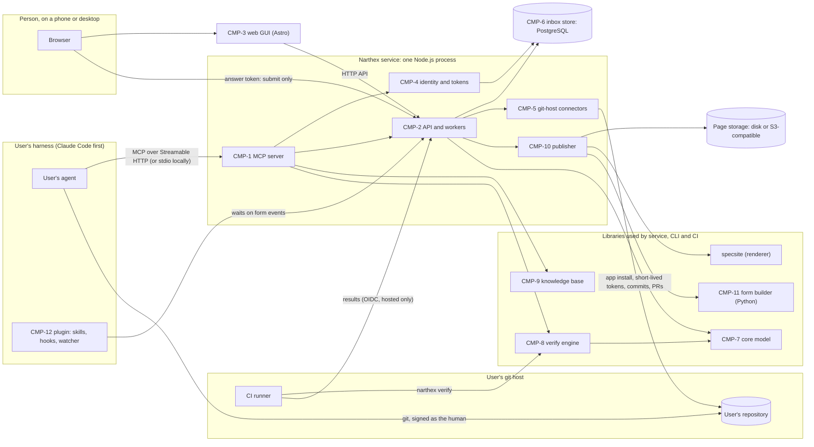
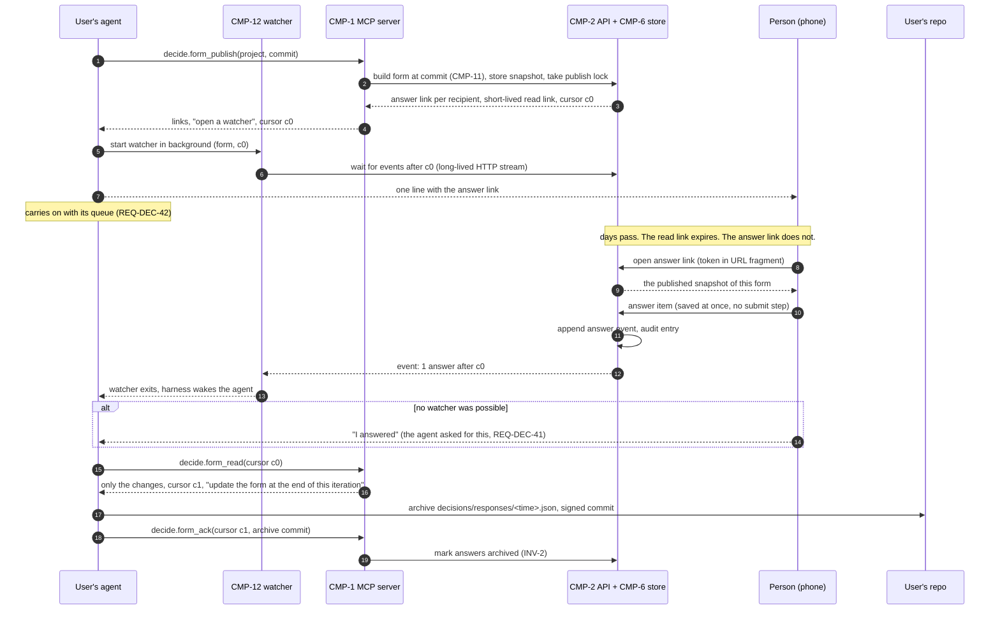
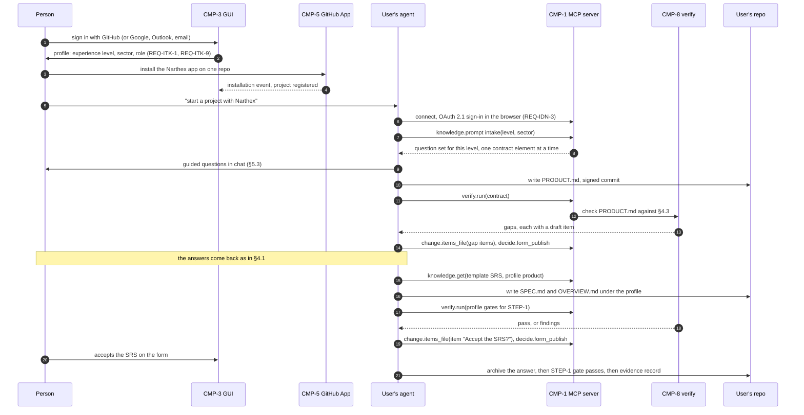
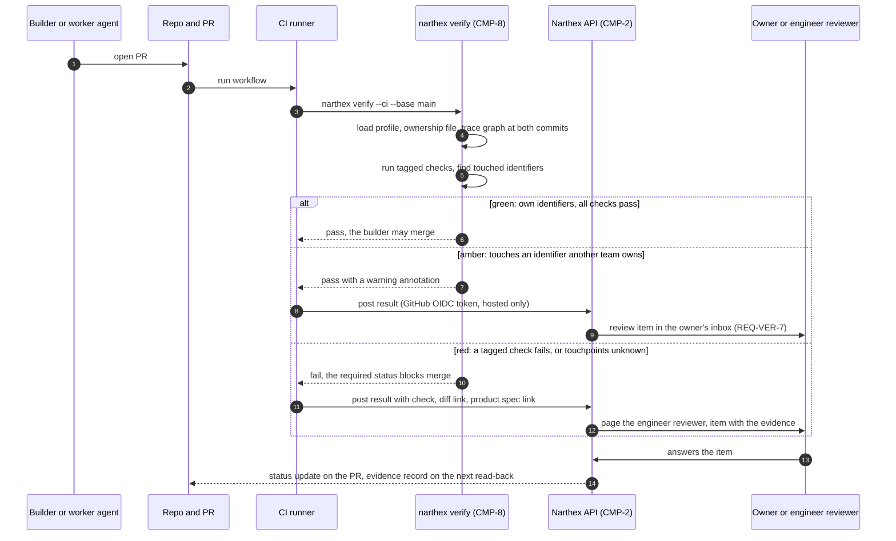

# Narthex: software architecture description

This is the SAD of Narthex itself, written in `STEP-2` of Narthex's own chain (`REQ-CHN-8`). It says how the
system meets `SPEC.md` v0.3.4. Each key choice is an ADR in `docs/architecture/adr/`, and each ADR has a decision
item `adr-NNNN` on the form (`REQ-CHN-9`). Every ADR is **proposed** until its item is answered.

Narthex's own repository keeps this file at `docs/architecture/SAD.md` and its ADRs at `docs/architecture/adr/`.
Under `REQ-DAT-1` these are renamed documents (`ARCHITECTURE.md`, `adr/`), so the project configuration must
name them once it exists (§11.1).

Claims about third-party tools cite their official documentation in §14. A claim we could not check is marked
*unverified*.

---

## 1. Context and constraints

### 1.1 What the system does

Narthex turns a user's own agent into a senior software architect (§1.3 of the spec). It does that with:

- an **MCP server** the agent calls for knowledge, project data, changes, checks and decisions (`REQ-IFC-1`);
- a **web GUI** where people read documents and answer decision items (`REQ-IFC-3`);
- **skills and hooks** installed in the agent's harness (`REQ-SKL-32`);
- **checks** that run the same way locally, through the MCP and in CI (`REQ-VER-3`).

Narthex runs no model of its own (`REQ-VER-12`, `REQ-IFC-7`). The user's agent is the only natural-language layer.

### 1.2 Constraints

| Constraint | Source | What it forces |
|---|---|---|
| MIT, open source first | R25, §1.8 | Every component is in the public repo. No component may depend on a closed service to run (`REQ-IDN-8`) |
| Hosted service and self-host | R27, `REQ-IDN-8` | One build runs both ways. The hosted service is the self-host package, run by Swimming on Code |
| Local use with no service | `REQ-IDN-8`, `REQ-DEC-38` | Reading, building and checking work from the repo alone, with no account |
| MCP first, plus a web GUI | R3, R8, `REQ-IFC-1` to `REQ-IFC-4` | People decide in the GUI. The MCP hands the agent links, not long text |
| User-owned git repos | R7, `REQ-IDN-1`, `REQ-IDN-2` | Narthex is an app on GitHub, GitLab and Codeberg. It never hosts code |
| Repo is the record | `REQ-DAT-4`, `REQ-DAT-15`, `INV-2` | Narthex's database is an inbox and an index. Nothing lives only there |
| Short-lived read tokens, long-lived narrow answer tokens | R20, `REQ-IFC-9`, `REQ-IFC-10`, `INV-17` | A token service with purpose-bound tokens (ADR-0007) |
| Short-lived git credentials per task | `REQ-IDN-4` | Agents get git-host tokens minted per task. The server holds the long-lived secrets |
| Unattended forms are the norm | R22, `REQ-DEC-39` to `REQ-DEC-42` | No polling by the agent. Answers wait in the store until a channel or the person wakes the agent (ADR-0010) |
| Narthex generates its own pages | R23, `REQ-DOC-16`, `INV-18` | The form and the editions are built by Narthex and served from its own host. claude.ai artifacts are one optional target (ADR-0009) |
| Sector profiles as data | `REQ-DAT-18`, `REQ-KNB-9` | Checks read a profile file. No profile is code |
| Token budget of the user's agent | `NFR-8` to `NFR-11`, `REQ-DEC-24`, `REQ-IFC-2` | Small MCP responses, incremental reads, few tools with short descriptions (§9.2) |
| Few dependencies for the builder | `NFR-4` | The form builder stays stock Python 3 |
| Phone first | `NFR-2`, `NFR-6`, `REQ-DEC-18` | The GUI ships little JavaScript; the form loads in under two seconds on 4G |
| Small team | R24, the business-model note | Boring, well-documented, open-source tools. One deployable service. One database |

### 1.3 What exists today

- The `decision-form` skill (stock Python): it builds `decisions/questions.json` into one self-contained page.
  The page saves answers through a claude.ai artifact's database, or in the browser.
- specsite (TypeScript, Astro and Starlight, MIT, `swimmingoncode/specsite`): it renders the repo's Markdown into
  pages with identifier anchors and single-file HTML editions (`REQ-DOC-13`).
- The Claude Code plugin packaging of the skills (`.claude-plugin/`).

The architecture keeps all three. It adds the server, the GUI, the token service, the git-host connectors, the
verify engine and the knowledge base.

---

## 2. Components

Each component has an identifier (`CMP-N`), a build mode (`REQ-CHN-10`), and the requirements it serves. All are
built as code. The full allocation is in §12.

| ID | Component | Package or path | Responsibility | Serves |
|---|---|---|---|---|
| `CMP-1` | MCP server | `apps/server` (module `mcp`), `packages/cli` for stdio | The five tool groups: knowledge, spec data, change, verify, decide. Small, structured responses. Streamable HTTP when hosted; stdio when local (ADR-0002) | `REQ-IFC-1`, `REQ-IFC-2`, `REQ-IFC-4`, `REQ-IFC-6`, `REQ-IFC-7`, `REQ-IFC-12`, `REQ-KNB-2`, `REQ-DEC-23`, `REQ-DEC-24`, `NFR-8` |
| `CMP-2` | API and workers | `apps/server` (modules `api`, `jobs`) | HTTP API for the GUI and the form page. Background jobs: build forms, render documents, run checks on a commit, send notifications | `REQ-DEC-17`, `REQ-DEC-22`, `REQ-DEC-36`, `REQ-DEC-37`, `REQ-DOC-1`, `REQ-DOC-11` |
| `CMP-3` | Web GUI | `apps/web` (Astro, ADR-0003) | Sign-up and intake profile, the decision inbox across projects, the documents, project status per step | `REQ-IFC-3`, `REQ-ITK-1`, `REQ-ITK-5`, `REQ-DEC-12` to `REQ-DEC-19`, `REQ-DOC-6`, `NFR-2`, `NFR-3`, `NFR-6` |
| `CMP-4` | Identity and token service | `apps/server` (module `auth`) | Sign-in for people. OAuth 2.1 authorization server for agents. Read, answer and refresh tokens. Role checks (ADR-0006, ADR-0007) | `REQ-ITK-2`, `REQ-ITK-3`, `REQ-IDN-3`, `REQ-IDN-7`, `REQ-IFC-9` to `REQ-IFC-11`, `REQ-TEM-4`, `INV-17` |
| `CMP-5` | Git-host connectors | `apps/server` (module `githost`), one adapter per host | Install as an app, mint short-lived task tokens, read files at a commit, open commits and PRs, receive webhooks (ADR-0008) | `REQ-IDN-1`, `REQ-IDN-2`, `REQ-IDN-4` to `REQ-IDN-6`, `INV-8`, `INV-16` |
| `CMP-6` | Inbox store | PostgreSQL (ADR-0005) | Accounts, organisations, teams, projects, published form snapshots, answers until archived, read cursors, token hashes, audit log, job queue | `REQ-DAT-15`, `REQ-DEC-15`, `REQ-DEC-17`, `REQ-DEC-24`, `INV-2`, `INV-3`, `NFR-5` |
| `CMP-7` | Core model | `packages/core` | The data model and its JSON Schemas; parsing the repo layout; identifiers; the trace graph and its three queries; the `needs.json` export. No I/O of its own | `REQ-DAT-1` to `REQ-DAT-20`, `REQ-CHN-6`, `REQ-CHN-15` |
| `CMP-8` | Verify engine | `packages/verify`, run by `packages/cli` and a CI action (ADR-0012) | The deterministic checks of §7.6, profile gates, alarm tiers. One rule set for local, MCP and CI | `REQ-VER-1` to `REQ-VER-10`, `REQ-VER-13`, `REQ-CHN-2`, `REQ-CHN-3`, `REQ-CHN-5`, `REQ-DAT-13`, `NFR-1` |
| `CMP-9` | Knowledge base | `kb/` (content), served by `CMP-1` (ADR-0013) | The method, templates, explanations per level, question sets, profiles, golden paths. Versioned. Paid packs come from a separate store | `REQ-KNB-1` to `REQ-KNB-12`, `REQ-ITK-7`, `REQ-ITK-15`, `REQ-DAT-18` |
| `CMP-10` | Renderer and publisher | specsite (dependency) plus `apps/server` (module `publish`) | Render documents at a commit; host pages and built forms on Narthex's domain; export to any static host or a claude.ai artifact | `REQ-DOC-1` to `REQ-DOC-16`, `INV-5`, `INV-6`, `INV-13`, `INV-18` |
| `CMP-11` | Form builder | `skills/decision-form` (stock Python, kept) | Check items, build the form page and the log. Gains a store adapter so the same page works on Narthex's host (ADR-0009) | `REQ-DEC-1` to `REQ-DEC-11`, `REQ-DEC-43`, `REQ-DEC-44`, `REQ-DAT-2`, `REQ-DAT-3`, `NFR-1`, `NFR-4` |
| `CMP-12` | Agent-side plugin | `skills/`, `.claude-plugin/`, `packages/cli` (watcher) | The workflow skills, the guard hooks, the answer watcher, a channel once the harness allows it (ADR-0010) | `REQ-SKL-1` to `REQ-SKL-35`, `REQ-IFC-5`, `REQ-IFC-6`, `REQ-DEC-30`, `REQ-DEC-39` to `REQ-DEC-42` |

`CMP-1`, `CMP-2`, `CMP-4` and `CMP-5` are modules of one Node.js process (ADR-0001, ADR-0011). They are separate
components because their contracts differ; they share one deployable so a small team runs one thing.

### 2.1 What each component must not do

- `CMP-1` returns links into the GUI where a person must read or decide; it never restates the content
  (`REQ-IFC-4`). It never runs a model (`REQ-IFC-7`).
- `CMP-5` never stores repository content beyond one job's working copy, and never pushes to a protected branch.
- `CMP-6` is never the only home of an answer for longer than one read-back (`REQ-DAT-15`, `INV-2`).
- `CMP-11` stays stock Python 3 with no packages (`NFR-4`).
- `CMP-12` never overrides the git identity or signing, and its hooks refuse commands that do (`INV-8`,
  `REQ-SKL-27`).

---

## 3. Component diagram

Local mode drops the service. The agent runs `narthex mcp --stdio` from `packages/cli`, which serves the knowledge,
spec data and verify groups from the repo and the bundled knowledge base. Decisions then go through a form
published as a claude.ai artifact or a static page, as today (`REQ-DEC-38`, `REQ-IFC-8`).

---

## 4. Key sequences

### 4.1 Answering a form unattended over days

The agent publishes, hands over one link, and moves on. Nothing polls. The answer waits in the store until a
watcher or the person wakes the agent (R21, R22).

Notes:
- The answer token lets its holder load the snapshot it was issued with and submit answers. It does not show
  later state. To see later changes, the person needs a session, or asks for a fresh link (`REQ-IFC-11`).
  The request is an event the agent sees on its next read.
- If the agent never reads back, the answers stay in the store. They are never dropped by a rebuild (`INV-2`).
- On Claude Code, a channel (research preview today) can replace the watcher once it leaves preview (ADR-0010).

### 4.2 Intake, product specification, then SRS

### 4.3 A verify run in CI raising an alarm

The verify engine works with no service at all: steps 1 to 5 and the exit code are the whole check. Posting to
the API only adds routing. Self-hosters point it at their own server.

---

## 5. Data and storage

### 5.1 What lives where

| Data | User's repo (the record) | Narthex database (inbox and index) | Page storage |
|---|---|---|---|
| Product spec, SRS, SAD, ADRs, plan, amendments, notes | Yes (`REQ-DAT-1`) | No | Rendered pages, per commit |
| Decision items | `decisions/questions.json` | The snapshot of each publish | The built form, per publish |
| Answers | `decisions/responses/*.json`, after read-back | Until archived, then kept 30 days as a safety copy, then deleted | No |
| Decision log | `decisions/LOG.md` (generated) | No | No |
| Ownership of identifiers | Ownership file, CODEOWNERS style (`REQ-TEM-2`) | A cached copy per commit, for routing | No |
| Profile choice, level | Spec front matter (`REQ-DAT-17`) | A cached copy | No |
| House rules | House-rules file (`REQ-SKL-17`) | No | No |
| Accounts, organisations, teams, roles | No | Yes | No |
| Git-host installations, app secrets | No | Installation ids only; secrets in the secret store | No |
| Tokens | No | Hashes only, with purpose, scope and expiry | No |
| Read cursors per agent | No | Yes | No |
| Audit log | No | Append only | No |
| Paid sector packs | No (never in an MIT repo, `REQ-KNB-12`) | Entitlements only | Pack content in a private store |

Repository content enters Narthex only in a job's working copy, which is deleted when the job ends. Rendered
pages of private repos are served only to people the project grants (`REQ-IDN-2`, `REQ-IDN-7`).

### 5.2 The database, in outline

Tables (names are proposals): `user`, `identity` (a sign-in method), `organisation`, `team`, `membership` (role),
`project` (repo link, git host, installation id), `form` (one per project, `INV-11`), `form_snapshot` (items as
published, commit, publisher, lock), `answer` (item id, choice, notes, at, by, archived_at), `event` (append-only
change feed per form, the source of cursors), `cursor` (agent, form, position), `token` (hash, purpose, scope,
subject, expiry, revoked_at), `link_request`, `job`, `audit`. Answers are rows, not documents, but keep the
artifact's `{choice, notes, at, by}` shape so the form page needs one adapter only (ADR-0009).

### 5.3 Consistency rules

- One publish lock per form. A publish whose base snapshot is stale is refused (`REQ-DEC-22`).
- An answer is an event first. Rebuilding a form never deletes answers (`INV-2`).
- A changed answer is a new row; the old one stays (`INV-3`).
- `form_ack` records the commit that archived a range of events. Only acknowledged answers age out.

---

## 6. Security model

### 6.1 Who signs in, and how

- **People** sign in to the GUI with GitHub, GitLab or Codeberg, or with Google, Microsoft (Outlook) or an email
  link (`REQ-ITK-2`, `REQ-ITK-3`). One person may link several sign-in methods. Sessions are cookies:
  `HttpOnly`, `Secure`, `SameSite=Lax` (ADR-0006).
- **Agents** sign in to the MCP server with OAuth 2.1, authorization code with PKCE, as the MCP authorization
  specification describes (`REQ-IDN-3`). Narthex is both the authorization server and the resource server. It
  publishes protected resource metadata (RFC 9728), and accepts Client ID Metadata Documents. Dynamic client
  registration is off unless a client needs it, since the current MCP revision deprecates it.
- **CI** authenticates to the API with the CI platform's OIDC token where it has one (GitHub Actions does). No
  long-lived CI secret is stored (ADR-0012).

### 6.2 Tokens

The token model is ADR-0007. In short:

| Token | Holder | Allows | Lifetime |
|---|---|---|---|
| MCP access token | An agent | The tool groups its scopes name, for the projects its user can reach. Audience-bound to the MCP server | About 1 hour; refresh tokens rotate |
| Read link | Anyone the agent hands it to | Read one form's current state | About 15 minutes |
| Answer link | One person, for one form | Load that form's published snapshot and submit answers to the items routed to them. Nothing else | Until revoked or the form is closed (R20, `INV-17`) |
| Git task token | An agent, for one task | The repositories and permissions the task needs, from the app installation | GitHub sets 1 hour |
| Session | A person's browser | The GUI, by role | Proposed: 30 days, sliding |

All Narthex tokens are random and opaque. The database keeps only their hash. Link tokens travel in the URL
fragment, which browsers do not send to servers, and the page trades them for a short session over a POST. MCP
access tokens never go in a query string, as the MCP specification requires.

### 6.3 Access control

Access is granted by role and by identifier ownership (`REQ-TEM-4`). The roles are those of §3.1: lead,
engineer, builder, engineer reviewer, viewer. On every answer, the server checks three things:

1. the token or session is valid for this form;
2. the item is routed to this person, by the ownership file at the published commit (`REQ-TEM-3`);
3. a reserved item is answered by the lead only (`INV-4`).

Agents can never answer items (§3.1). The MCP has no tool that writes an answer; relayed rulings are recorded
as items with `by: "relayed:<source>"` in the repo (`REQ-DEC-31`).

### 6.4 Secrets

- Server secrets (the GitHub App private key, OAuth client secrets, the database password, the token pepper)
  come from the environment, filled by the host's secret store. They are never in the repo or in logs.
- GitLab and Codeberg refresh tokens, where those hosts need them, are encrypted at rest with a key from the
  secret store (ADR-0008).
- Self-hosters get the same variables in one documented `.env` file.

### 6.5 Threats revisited

`STEP-2` must revisit the threat model against the design (`REQ-CHN-7`). Narthex's own SPEC v0.3.4 has no threat
model yet: it lists no `THR-` items. That is a `STEP-1` gap, and this table is a first input to it, not a
substitute.

| STRIDE | Threat | Mitigation in this design |
|---|---|---|
| Spoofing | A leaked answer link is used by someone else | One form, submit only, routed items only, revocable; every answer is audited and shown in the outbox with its time; the lead can revoke and reissue |
| Tampering | Answers are changed in the database | The repo archive is the record; a read-back shows what changed; archives are signed commits |
| Repudiation | Someone denies an answer | Audit log with the token id and sign-in method; `by` on every answer |
| Information disclosure | Private documents leak through rendered pages | Pages of private repos need a session or a read link; read links expire in minutes |
| Denial of service | Floods of answers or publishes | Rate limits per token and per project; publish lock |
| Elevation of privilege | An agent's task token writes to a protected branch | Task tokens carry only the permissions the task needs; branch protection stays on the host; agents open PRs |
| Elevation of privilege | A prompt-injected agent tries to answer its own items | No MCP tool answers items; agents cannot hold answer tokens for reserved items |

---

## 7. Deployment

### 7.1 Three ways to run

| Mode | Who | What runs | Needs |
|---|---|---|---|
| Local | Anyone, no account | `narthex mcp --stdio` and `narthex verify` from `packages/cli`; the form as a static page or claude.ai artifact | Node.js; Python 3 for the builder |
| Self-hosted | A team that wants its own | The same container image as the hosted service, PostgreSQL, a disk or S3-compatible bucket, its own GitHub App | A server with Docker |
| Hosted | Everyone else | The same image, run by Swimming on Code (ADR-0004) | A browser and a git-host account |

### 7.2 The hosted service

- One container image: the Node.js server (MCP, API, auth, connectors, publisher, jobs) and the built GUI.
  Python 3 is in the image for the form builder.
- PostgreSQL with daily backups and point-in-time recovery where the host offers it.
- Page storage on an S3-compatible bucket, or local disk behind the server.
- A reverse proxy with TLS in front. Streamable HTTP and the watcher's event stream need long-lived HTTP
  responses, so the proxy must not cut them short.
- Jobs run in the same process from a PostgreSQL-backed queue, so there is no second service to run.
- Domains: one for the GUI and API, one for the MCP endpoint, one for user-content pages. Rendered user content
  stays off the GUI's domain, so a page cannot read GUI cookies.

### 7.3 Releases

The server, the CLI and the plugin are versioned together from the monorepo (ADR-0011). Database migrations run
on start, forward only, each with a tested rollback script (`REQ-CHN-15` applied to ourselves).

---

## 8. Observability

- **Logs:** structured JSON. Never tokens, answer text or document content. Every line carries a request id.
- **Traces and metrics:** OpenTelemetry, exported to whatever the operator runs. The hosted service starts with
  a small open-source stack or a free tier.
- **Signals for the first SLOs** (`STEP-5` sets the numbers):
  - answer submits that succeed (the most important: `INV-17`);
  - time from an answer to the watcher's wake-up;
  - publish failures and lock refusals;
  - git-host token mint failures, by host;
  - MCP response size per tool, against the budget of §9.2 (`NFR-8`);
  - render and build job time.
- **Audit log:** separate from logs, append only, kept for the life of the project. It records sign-ins, token
  issues and revocations, answers, publishes, and every write to a user's repo.

---

## 9. Cost drivers

### 9.1 Money

| Driver | Size at start | Notes |
|---|---|---|
| Compute for one server | Small | One process; most requests are small JSON |
| PostgreSQL | Small | Answers and events are tiny; the audit log grows slowest of all |
| Rendering documents | The largest compute cost | A full Starlight build per commit is heavy. Render on publish only, cache per commit, prefer single-file editions for forms |
| Page storage and egress | Small | Static pages, cached per commit |
| Email | Small | Email sign-in links and optional notifications |
| Model use | None | Narthex runs no model (`REQ-VER-12`) |

A rough figure for the first months is €10 to €40 a month on one rented server (*unverified estimate*; ADR-0004
compares options).

### 9.2 The user's tokens

The user pays for the agent's context. The MCP surface is designed to keep it small:

- **Few tools, short descriptions.** Tool definitions sit in the agent's context. The M0 list has 14 tools (§11.2).
  Each description stays under about 60 words.
- **Incremental reads.** `decide.form_read` returns only events after the agent's cursor (`REQ-DEC-24`).
- **One piece at a time.** Knowledge is fetched by id (`REQ-IFC-2`); search returns ids and titles only.
- **Budgets.** Design targets: a typical tool response under 2 KB, any response under 16 KB; larger results are
  paged or turned into a GUI link. CI checks these budgets on recorded sessions.
- **No waiting in context.** The watcher is a script; the agent's turn never waits on it (`NFR-9`).

---

## 10. Walking skeleton for M0

The thinnest end-to-end slice: **one newcomer-level persona signs in with GitHub on the hosted service, connects
their agent, goes from intake to a product specification and an SRS under the `product` profile, and the lead
approves the SRS on a form hosted by Narthex, with the answer coming back to the agent without polling.**

### 10.1 In the slice

1. GUI: sign in with GitHub; profile (level, sector, role); install the GitHub App on one repo.
2. MCP over Streamable HTTP with OAuth 2.1; 14 tools (§11.2).
3. Knowledge base: the `product` profile, the intake question set for one level, the templates for
   `PRODUCT.md` and `SPEC.md`.
4. Verify engine: the input-contract check (`REQ-CHN-5`), reference and duplicate checks, the `product` profile's
   `STEP-1` gate. Run by the CLI, the MCP and a CI workflow.
5. Form builder with the Narthex store adapter; the form hosted on Narthex's domain; answer and read links.
6. The watcher in the Claude Code plugin; the acknowledge fallback.
7. Read-back, archive by a signed commit made by the human's agent, `form_ack`.

### 10.2 Left out of the slice

GitLab and Codeberg; teams, ownership routing and amber or red alarms; sector profiles other than `product`;
the docs site and PDF; experiments; paid packs; email sign-in; notifications other than the agent's own.

### 10.3 Done when

- The scenario runs end to end on the hosted service, and on a self-hosted copy from the same image.
- The synthetic "unattended form" scenario of `notes/2026-10-17-testing-narthex.md` passes: the persona answers
  after a simulated delay, past the read link's expiry, and the agent resumes from one wake-up.
- The contracts of §11 are frozen at version 1.0.0 of their schemas.

---

## 11. Contracts M0 freezes

`REQ-CHN-12` asks the first milestone to freeze the contracts between components. M0 freezes four. Each is a
versioned JSON Schema or listing in `packages/core/schemas/`, with conformance fixtures that every
implementation (the Python builder, the TypeScript core, the server) must pass.

### 11.1 Data-model JSON Schemas

| Schema | Describes | Read by |
|---|---|---|
| `questions.schema.json` | `decisions/questions.json`: `form`, `sections`, `items` with every field of `REQ-DEC-1` and the `chain` of `REQ-DEC-43` | Builder, server, verify |
| `response.schema.json` | One archived answers file: `{choice, notes, at, by}` per item id | Builder, server |
| `event.schema.json` | One change-feed event: answer, edit, link request, publish; with its cursor | Server, MCP, watcher |
| `project.schema.json` | The project configuration file: renamed documents (`REQ-DAT-1`), id families, house-rules path, ownership-file path | Core, verify, server |
| `ownership.schema.json` | The ownership file: identifier patterns to owning teams (`REQ-TEM-2`) | Verify, server |
| `trace.schema.json` | Items and trace links as a `needs.json`-compatible export (`REQ-DAT-20`, §6.3, §6.4) | Core, verify, renderer |

### 11.2 MCP tools and resources

Tool names are short and grouped by prefix. Every tool returns structured content with a small text summary.

| Group | Tool | Does |
|---|---|---|
| knowledge | `knowledge_search` | Ids and titles of matching pieces, for a step and level |
| knowledge | `knowledge_get` | One piece by id and version |
| spec data | `spec_get` | One identifier: statement, attributes, source location |
| spec data | `spec_trace` | Depends on, depended on by, or impact of one identifier (`REQ-DAT-12`) |
| change | `items_file` | Add or update decision items; ends as a commit or PR (`REQ-IDN-5`) |
| change | `queue_update` | Reorder or close queue items; ends as a commit or PR |
| change | `amendment_propose` | Open a PR with a numbered amendment, its number reserved first (`REQ-DAT-8`) |
| change | `task_token` | A short-lived git-host token for one task (`REQ-IDN-4`) |
| verify | `verify_run` | Run named checks or a gate at a commit; a summary and the first findings |
| decide | `form_publish` | Build and publish the form at a commit; return the links |
| decide | `form_read` | Changes since a cursor, and the reminder to update the form (`REQ-DEC-24`) |
| decide | `form_wait` | Wait a short time for changes, then return "pending" (`REQ-IFC-6`) |
| decide | `form_ack` | Record the commit that archived a range of answers |
| decide | `link_get` | A fresh read link, or the answer link for a recipient |

Resources: `narthex://kb/{id}@{version}` for knowledge pieces and `narthex://profile/{name}@{version}` for
profiles. Prompts: one per skill step, starting with `intake` and `spec`. Recording a relayed ruling is done with
`items_file`, since it is an item with an answer in the repo.

### 11.3 Profile schema

`profile.schema.json` describes a sector profile as data (`REQ-DAT-18`): `id`, `version`, `extends`,
`level` (for `safety`), `sections` required, `families` (prefix, item type, required attributes), `notation`
(RFC 2119, EARS), `trace` (required links per type), `normative` (which artefact), `exports`, `gates` (per step:
the checks and the evidence each needs), `standards` (name, pinned edition, class of §7.1), and `disclaimer`
(`REQ-KNB-11`). M0 ships one instance, `product`, and validates the schema against drafts of the other four.

### 11.4 Token model

The token table of §6.2 and ADR-0007, as `tokens.md` plus a JSON listing of purposes, scopes and lifetimes. The
MCP scopes are: `knowledge:read`, `spec:read`, `change:write`, `verify:run`, `decide:read`, `decide:publish`.
Freezing it fixes what each link can do, so forms published in M0 keep working after later releases (`INV-17`).

---

## 12. Requirement allocation

Every requirement family is allocated to the components that carry it (`STEP-2` gate). Ranges are inclusive.

| Requirements | Components |
|---|---|
| `REQ-CHN-1` to `REQ-CHN-4` | `CMP-8` (gates), `CMP-12` (skills), `CMP-11` (tailoring items) |
| `REQ-CHN-5` to `REQ-CHN-7` | `CMP-8`, `CMP-9`, `CMP-12` |
| `REQ-CHN-8` to `REQ-CHN-12` | `CMP-12` (`design`, `plan` skills), `CMP-9` (templates), `CMP-8` (allocation check) |
| `REQ-CHN-13` to `REQ-CHN-18` | `CMP-8`, `CMP-7` (trace graph), `CMP-12`, `CMP-11` (validation and release items) |
| `REQ-ITK-1` to `REQ-ITK-3` | `CMP-3`, `CMP-4` |
| `REQ-ITK-4` to `REQ-ITK-15` | `CMP-3`, `CMP-9`, `CMP-12` (`intake` skill) |
| `REQ-DAT-1` to `REQ-DAT-13` | `CMP-7`, `CMP-8` |
| `REQ-DAT-14` to `REQ-DAT-16` | `CMP-11`, `CMP-6`, `CMP-12` |
| `REQ-DAT-17` to `REQ-DAT-20` | `CMP-7`, `CMP-9` |
| `REQ-KNB-1` to `REQ-KNB-12` | `CMP-9`, `CMP-1` (serving), `CMP-10` (labels) |
| `REQ-DEC-1` to `REQ-DEC-11` | `CMP-11`, `CMP-7` (schema) |
| `REQ-DEC-12` to `REQ-DEC-19` | `CMP-11` (the page), `CMP-3` (the inbox) |
| `REQ-DEC-20` to `REQ-DEC-22` | `CMP-1`, `CMP-2`, `CMP-12` |
| `REQ-DEC-23` to `REQ-DEC-32` | `CMP-1`, `CMP-6`, `CMP-12` (`decide` skill) |
| `REQ-DEC-33` to `REQ-DEC-35` | `CMP-11`, `CMP-12` (`amend` skill) |
| `REQ-DEC-36` to `REQ-DEC-38` | `CMP-2`, `CMP-12`; `REQ-DEC-38` by local mode (§7.1) |
| `REQ-DEC-39` to `REQ-DEC-42` | `CMP-12` (watcher), `CMP-1`, `CMP-2` (event feed) |
| `REQ-DEC-43`, `REQ-DEC-44` | `CMP-11` |
| `REQ-DOC-1` to `REQ-DOC-16` | `CMP-10` (specsite and publisher), `CMP-3` (modal peek) |
| `REQ-SKL-1` to `REQ-SKL-35` | `CMP-12`; `REQ-SKL-27` by its hooks |
| `REQ-EXP-1` to `REQ-EXP-7` | `CMP-12` (`experiment` skill), `CMP-11` (separate logs) |
| `REQ-VER-1` to `REQ-VER-13` | `CMP-8`; routing by `CMP-2`; `REQ-VER-12` by the user's CI |
| `REQ-IDN-1` to `REQ-IDN-8` | `CMP-5`, `CMP-4`, deployment (§7) |
| `REQ-IFC-1` to `REQ-IFC-12` | `CMP-1`, `CMP-3`, `CMP-4`, `CMP-12` |
| `REQ-TEM-1` to `REQ-TEM-7` | `CMP-4` (roles), `CMP-2` (routing), `CMP-8` (ownership checks), `CMP-12` (`propose-upstream`) |
| `INV-1` to `INV-4`, `INV-9` to `INV-11`, `INV-17` | `CMP-11`, `CMP-6`, `CMP-4` |
| `INV-5`, `INV-6`, `INV-13`, `INV-14`, `INV-18` | `CMP-10`, `CMP-9` |
| `INV-7`, `INV-8`, `INV-12`, `INV-15`, `INV-16` | `CMP-12`, `CMP-5`, `CMP-8` |
| `NFR-1`, `NFR-4` | `CMP-11` |
| `NFR-2`, `NFR-3`, `NFR-5`, `NFR-6` | `CMP-3`, `CMP-11`, `CMP-6` |
| `NFR-7` | All content components |
| `NFR-8` to `NFR-11` | `CMP-1`, `CMP-12` |

---

## 13. Open points and risks

- **GitLab and Codeberg have no installation tokens.** GitLab issues OAuth tokens that expire after two hours,
  with refresh tokens. Forgejo, which runs Codeberg, documents that its OAuth2 scopes are not yet implemented, so
  a token can act on anything its user can. Narthex can still give agents only short-lived tokens, but must hold
  refresh tokens itself, and on Codeberg cannot narrow them yet (ADR-0008; Forgejo status *unverified* for
  Codeberg's own instance).
- **Channels are a research preview** in Claude Code. The watcher is the working layer until they leave it
  (`notes/2026-10-17-ui-feedback.md`).
- **Long tool calls.** Whether every client tolerates `form_wait` holding a call open is not known; the wait is
  kept short (ADR-0010).
- **The identity library is young.** ADR-0006 picks an embedded open-source library; its security record over
  time is *unverified*.
- **No threat model in SPEC.** §6.5 is a first input; the SRS needs `THR-` items before the `STEP-2` gate can
  pass in full.
- **Experience level wording.** SPEC §3.3 calls the "casual vibe-coder" a `newcomer`. The M0 persona follows the
  spec's `newcomer` row.

---

## 14. Sources

Official documentation, read on 2026-10-17.

- MCP transports, revision 2025-06-18: https://modelcontextprotocol.io/specification/2025-06-18/basic/transports
- MCP authorization, latest revision (2026-07-28): https://modelcontextprotocol.io/specification/latest/basic/authorization
- MCP TypeScript SDK: https://github.com/modelcontextprotocol/typescript-sdk
- GitHub App installation tokens: https://docs.github.com/en/apps/creating-github-apps/authenticating-with-a-github-app/generating-an-installation-access-token-for-a-github-app
- GitHub commit signature verification (bots and apps): https://docs.github.com/en/authentication/managing-commit-signature-verification/about-commit-signature-verification
- GitLab as an OAuth 2.0 provider: https://docs.gitlab.com/integration/oauth_provider/
- Forgejo as an OAuth2 provider: https://forgejo.org/docs/latest/user/oauth2-provider/
- Better Auth MCP plugin: https://www.better-auth.com/docs/plugins/mcp
- Better Auth generic OAuth plugin: https://www.better-auth.com/docs/plugins/generic-oauth
- Astro Node adapter: https://docs.astro.build/en/guides/integrations-guide/node/
- Node.js releases: https://nodejs.org/en/about/previous-releases
- Hetzner Cloud: https://www.hetzner.com/cloud
- specsite README: https://github.com/swimmingoncode/specsite
- Claude Code channels, hooks and MCP: see `notes/2026-10-17-ui-feedback.md`
